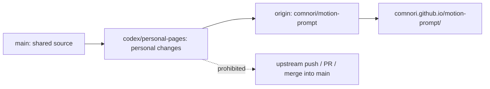

# Personal GitHub Pages branch

These instructions apply to this checkout on `codex/personal-pages`.

- Keep personal deployment changes on `codex/personal-pages`. Push only this branch to `origin` (`https://github.com/comnori/motion-prompt.git`).
- Never push this work to `upstream`, open an upstream pull request, or merge this branch into `main` or a contribution branch.
- Keep the default branch as `main`. GitHub Pages publishes `codex/personal-pages` at `/(root)` using `.nojekyll`.
- Preserve original authorship, MIT license, third-party notices, and explicitly labeled upstream skill/contribution/contact links. Do not change the skill CLI or enable Issues for this deployment.
- Edit generated URLs in `tools/build.mjs`, then run `node tools/build.mjs`; do not hand-edit the generated catalog, API files, or pack name lists.
- Before publishing, run `node tools/build.mjs --check`, `node tools/test-localization.mjs`, and `node tools/check-localization.mjs` with `MP_PLAYWRIGHT` pointing to an available Playwright package.
- Use Mermaid for relationships and processes in Markdown documentation. Prefer tables for comparisons.
