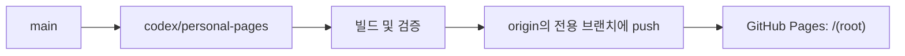
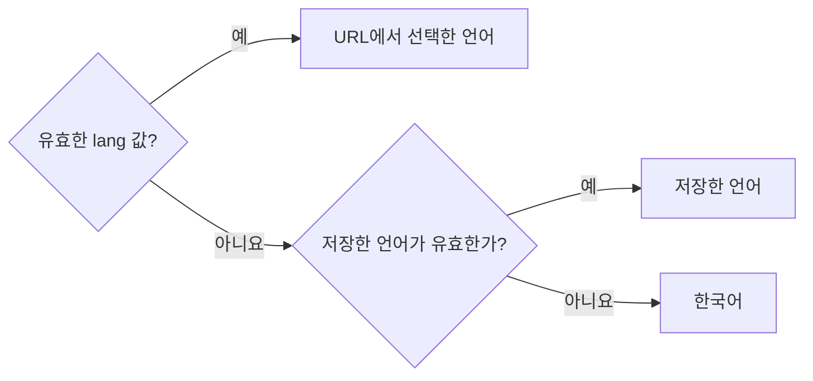

# 개인 GitHub Pages

[개인 갤러리](https://comnori.github.io/motion-prompt/) · [개인 배포 소스](https://github.com/comnori/motion-prompt/tree/codex/personal-pages) · [원본 프로젝트](https://github.com/showheyohtaki/motion-prompt)

comnori가 운영하는 한국어 기본 개인 배포입니다. 원작자는 Shohei Ohtaki이며, 기존 MIT 라이선스와 외부 자료 출처를 유지합니다. 원본 스킬 설치·기여·문의 안내는 원본 프로젝트를 대상으로 합니다. 스킬 CLI의 기본 접속 주소는 변경하지 않았습니다.

## 변경과 배포



이번 변경은 `codex/personal-pages`에만 유지합니다. `main`이나 기여 브랜치로 역병합하지 않으며, 상위 저장소 대상 push·PR을 만들지 않습니다. 원본 변경이 필요하면 `main`에서 이 브랜치로 가져온 뒤 개인 배포 설정을 다시 검증합니다.

GitHub Pages의 게시 소스는 **Deploy from a branch → codex/personal-pages → /(root)**입니다. `.nojekyll`을 유지하고, 생성 파일을 전용 브랜치에 함께 커밋합니다. [GitHub Pages 게시 소스 설정](https://docs.github.com/en/pages/getting-started-with-github-pages/configuring-a-publishing-source-for-your-github-pages-site)

```sh
node tools/build.mjs
node tools/build.mjs --check
node tools/test-localization.mjs
node tools/check-localization.mjs
git push origin HEAD:refs/heads/codex/personal-pages
```

브라우저 검증은 Playwright가 필요합니다. `MP_PLAYWRIGHT` 환경 변수로 설치된 패키지 경로를 지정할 수 있습니다. 게시 후 갤러리, 사례, 카탈로그, 프롬프트 및 참고 코드 URL의 응답을 확인합니다. 배포 문제가 있으면 전용 브랜치의 문제 커밋을 revert하고 다시 push합니다.

## 언어 선택



영어·일본어 전환과 선택 저장은 유지합니다. 브라우저 언어와 관계없이 첫 방문의 기본 언어는 한국어이며, 저장소 접근이 차단되어도 URL 언어 선택은 사용할 수 있습니다.
