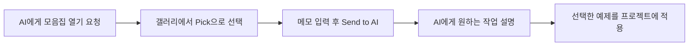
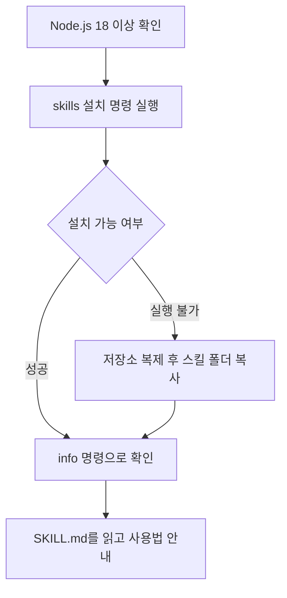
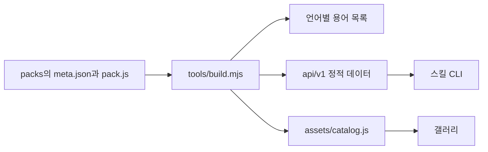

# Motion Prompt

[English](README.md) | [日本語](README.ja.md) | **한국어**

> 한국어 용어 목록은 [`packs/`](packs/README.ko.md)에서 볼 수 있습니다. 영어·일본어·스페인어·중국어 간체·중국어 번체 목록도 제공됩니다.
> 갤러리와 CLI는 영어·일본어를 지원합니다. 한국어 번역은 이 README와 팩의 이름·뜻·AI 요청 예시에 적용되어 있으며, [한국어 예제 영상 6편과 제작 안내](make-your-own/README.ko.md)도 제공합니다.
> 다른 언어로 영상을 만들려면 [`make-your-own/prompts/en/01-translate.md`](make-your-own/prompts/en/01-translate.md)를 코딩 AI에 전달하세요.

AI에게 무언가를 만들어 달라고 할 때 쓸 수 있는 **이름 모음집**입니다. 각 이름에는 움직이는 예제, 한 줄 설명, 요청 예시가 있습니다. 현재 8개 팩에 24개씩, 총 192개 용어를 담았습니다. 모션 그래픽 움직임(`motion`), 카메라 움직임(`camera`), UI 컴포넌트 이름(`ui`), 랜딩 페이지와 웹 효과(`lp`), 사진 표현·조명·스타일(`photo`), 모션 그래픽 움직임 2(`motion2`), 랜딩 페이지와 웹 효과 2(`lp2`), 카메라 움직임과 장면 전환 2(`camera2`)입니다. 자신의 분야와 언어로 같은 형태의 모음집을 만들 수 있는 프롬프트도 제공합니다.

| 모션 그래픽 | 카메라 움직임 |
|---|---|
|  |  |

- [갤러리: 모든 움직이는 예제](https://showheyohtaki.github.io/motion-prompt/)
- [GitHub에서 읽는 한국어 용어 목록](packs/README.ko.md)
- [다른 사람들이 공유한 이름과 예제: X 게시물 임베드와 링크](https://showheyohtaki.github.io/motion-prompt/found.html)

## 만든 이유

모션 그래픽과 카메라 움직임에 이름을 붙인 짧은 영상 몇 개를 올렸더니 며칠 동안 많은 댓글이 달렸습니다. 그중 한 댓글은 이런 뜻이었습니다. 막히는 이유는 상상력이 부족해서가 아니라, 이런 움직임을 뭐라고 부르는지 몰라서였다고요.

그 댓글을 읽고 생각했습니다. 각 분야를 잘 아는 사람들이 여러 언어로, AI와 잘 협업하는 데 필요한 '공통 언어'를 둘러볼 수 있는 모음집으로 정리한다면 유용하겠다고요. 그래서 GitHub 저장소로 만들어 보았습니다.

하나의 스타일을 그대로 따라 하는 곳은 아닙니다. 이곳의 프롬프트와 안내로 이런 모션 그래픽을 만들고, 자신의 분야에서도 원하는 스타일과 언어로 비슷한 용어 예제를 만들 수 있는 공간입니다.

또 다른 댓글에는 '이렇게 크리에이티브 디렉터가 되는 거군요'라고 적혀 있었습니다. 맞습니다. 전 세계에서 더 많은 크리에이티브 디렉터가 AI와 함께 멋진 작업을 한다면 정말 좋은 일이라고 생각합니다.

Shohei Ohtaki

## 현재 수록된 용어

| 번호 | 팩 | 용어 수 | 한국어 목록 |
|---|---|---|---|
| 001–024 | `motion`: 모션 그래픽 움직임 | 24 | [한국어](packs/motion/README.ko.md) |
| 025–048 | `camera`: 카메라 움직임과 장면 전환 | 24 | [한국어](packs/camera/README.ko.md) |
| 049–072 | `ui`: UI 컴포넌트 이름 | 24 | [한국어](packs/ui/README.ko.md) |
| 073–096 | `lp`: 랜딩 페이지와 웹 효과 | 24 | [한국어](packs/lp/README.ko.md) |
| 097–120 | `photo`: 사진 표현·조명·스타일 | 24 | [한국어](packs/photo/README.ko.md) |
| 121–144 | `motion2`: 모션 그래픽 움직임 2 | 24 | [한국어](packs/motion2/README.ko.md) |
| 145–168 | `lp2`: 랜딩 페이지와 웹 효과 2 | 24 | [한국어](packs/lp2/README.ko.md) |
| 169–192 | `camera2`: 카메라 움직임과 장면 전환 2 | 24 | [한국어](packs/camera2/README.ko.md) |

각 목록에는 번호, 이름, 뜻, AI 요청 예시가 있습니다. 한국어 목록에는 영어 원어도 함께 표시합니다. [전체 팩 목록](packs/README.ko.md)에서 다른 언어로 이동할 수 있으며, [갤러리](https://showheyohtaki.github.io/motion-prompt/)에서는 같은 이름의 움직이는 예제를 볼 수 있습니다.

팩마다 시각적 스타일이 다릅니다. `motion`과 `motion2`는 짙은 네이비 바탕에 네 가지 색을, `camera`와 `camera2`는 밝은 회색 바탕에 파란색 하나를 사용합니다. `ui`는 따뜻한 흰색 바탕에 검정과 파랑을 사용하며 커서가 각 요소를 움직입니다. `lp`와 `lp2`는 옅은 회색 책상 위에 흰 브라우저 창을 그리고, 주홍색을 강조색으로, 파란색을 페이지 안의 이미지에 사용합니다. `photo`에는 공통 색상표가 없습니다. 카드마다 장면에 맞는 색을 쓰고, 효과가 나타났다 사라져 전후를 비교할 수 있습니다. 의도한 차이입니다. 팩에서 가장 중요한 것은 통일된 스타일보다 정확한 이름입니다.

## 세 가지 사용 방법

### 1. 모음집에서 고르고 AI에게 보내기

Claude Code나 Codex에 `motion-prompt` 스킬을 설치했다면 말로 요청해 갤러리를 열 수 있습니다. 이름이나 번호를 기억할 필요가 없습니다. 무엇이라고 부르는지 모르겠다면 사전을 찾듯 모음집을 열어 보세요.

```sh
npx skills add showheyohtaki/motion-prompt
```



AI에게 다음과 같이 요청합니다.

```text
motion-prompt 모음집을 열어 줘.
```

브라우저에서 원하는 예제의 **Pick**을 누르세요. 여러 개를 선택할 수 있습니다. 화면 아래 메모란에 '오프닝 제목에 사용'처럼 짧은 설명을 적고 **Send to AI**를 누르면 선택한 항목이 AI에게 전달됩니다. AI로 돌아가 원하는 작업을 설명하세요.

```text
이 영상의 도입부를 이렇게 편집해 줘.
```

에이전트는 선택한 항목의 사양과 참고 코드를 가져와 프로젝트의 제작 방식에 맞게 영상이나 사이트에 적용합니다. '카메라 움직임을 보여 줘'처럼 분야를 지정하면 해당 팩만 표시합니다. 2편이 있는 분야는 1편과 2편을 함께 보여 줍니다.

스킬이 없는 AI에서는 갤러리에서 항목을 선택하고 화면 아래의 **Copy picks**를 눌러 채팅에 붙여 넣으세요. 예제와 사양 URL도 포함됩니다.

**번호를 안다면** 갤러리를 거치지 않고 바로 요청할 수 있습니다.

```text
motion-prompt 스킬의 #012와 #045를 써서 이 제품 영상을 전문적으로 보이게 만들어 줘.
```

```text
제목이 나타나는 부분을 motion-prompt의 #005로 바꿔 줘. 길이와 앞뒤 전환은 유지해 줘.
```

```text
motion-prompt #032의 카메라 움직임을 Veo용 영어 프롬프트로 바꿔 줘. 피사체는 책상 위의 커피잔이야.
```

다른 설치 방법과 에이전트의 동작은 아래 [스킬 참고](#스킬-참고)에 있습니다.

### 2. 이름을 찾아 AI에게 전달하기

[용어 목록](packs/README.ko.md)이나 갤러리에서 원하는 효과를 찾고, 그 이름을 프롬프트에 쓰세요. 지속 시간, 강도, 움직일 대상을 덧붙이면 원하는 결과에 가까워집니다.

```text
제목을 아래에서 올라오는 마스크 리빌로 등장시켜 줘. 0.6초 동안 움직이고 각 줄에 약간씩 시간차를 줘.
```

```text
그녀의 얼굴을 향해 천천히 달리 인해 줘. 줌을 쓰지 말고 카메라를 이동해 줘.
```

이 방법에는 설치가 필요 없습니다. 코딩 AI, 영상 생성 모델, 사람에게 전달하는 작업 설명에도 같은 이름을 쓸 수 있습니다.

### 3. 자신의 분야나 언어로 만들기

[`make-your-own/`](make-your-own/README.ko.md)에는 코딩 AI에 복사해 전달할 프롬프트, 영상 렌더링 스크립트, 완성된 예제 두 세트가 있습니다. 한국어판에는 각 세트의 HTML 소스, 영상 세 편과 검수용 프레임 모음이 있습니다. 기존 영어·일본어 예제에는 한 장짜리 용어 요약 이미지도 들어 있습니다.

| 목적 | 프롬프트(영어) |
|---|---|
| 같은 영상을 다른 언어로 만들기 | [`01-translate.md`](make-your-own/prompts/en/01-translate.md) |
| 자신의 분야를 원하는 스타일로 만들기 | [`02-your-own-field.md`](make-your-own/prompts/en/02-your-own-field.md) |
| 한 장짜리 용어 요약 이미지 만들기 | [`03-cheatsheet-image.md`](make-your-own/prompts/en/03-cheatsheet-image.md) |

영상 분야일 필요는 없습니다. 조명, 소리, UI, 사진, 요리, 건축처럼 이름을 알아야 원하는 것을 요청할 수 있는 분야라면 모두 가능합니다.

## 자신의 분야 용어 추가하기

잘 아는 분야가 있다면 그 분야의 공통 언어를 자신의 언어로 추가해 주세요. [CONTRIBUTING.md](CONTRIBUTING.md)에 팩이나 번역을 추가하는 방법과 용어의 수록 기준이 있습니다. 위 프롬프트로 코딩 AI가 제작의 상당 부분을 맡을 수 있습니다.

## 원본 게시물

이 프로젝트의 출발점이 된 영상입니다. X에 일본어로 게시되었습니다.

- [첫 번째 게시물](https://x.com/showheyohtaki/status/2108065874511077598)
- [두 번째 게시물](https://x.com/showheyohtaki/status/2109112248832503895)
- [세 번째 게시물](https://x.com/showheyohtaki/status/2109840044554891464)

첫 번째 게시물의 웹사이트·랜딩 페이지 애니메이션 용어 세트는 아직 이 저장소에 들어 있지 않습니다. `lp`는 별도로 만든 세트입니다. 패럴랙스, 스크롤 스냅 등 일부 이름은 겹치지만 선정과 예제는 이 저장소를 위해 새로 만들었습니다. `ui`는 10월 10일 X에 게시한 'UIパーツ名24'(UI 요소 이름 24개)를 바탕으로 했고, `photo`도 이 저장소를 위해 새로 만들었습니다.

## 스킬 참고

Node.js 18 이상이 필요합니다.

### 설치

**프롬프트로 설치.** Claude Code나 Codex에 다음 내용을 붙여 넣으세요.

```text
https://github.com/showheyohtaki/motion-prompt 를 읽고 이 환경에 motion-prompt 스킬을 설치해 줘. 설치가 끝나면 사용법을 세 줄로 알려 줘.
```

**명령어로 설치.** Claude Code, Codex 등 Agent Skills를 읽는 에이전트를 지원하는 `skills` 설치 도구를 사용합니다.

```sh
npx skills add showheyohtaki/motion-prompt
```

**Claude Code 플러그인으로 설치.**

```text
/plugin marketplace add showheyohtaki/motion-prompt
/plugin install motion-prompt@motion-prompt
```

**직접 설치.** `skills/motion-prompt` 폴더를 다음 위치 중 하나에 복사하세요.

| 위치 | 적용 범위 |
|---|---|
| `~/.claude/skills/` | Claude Code의 모든 프로젝트 |
| `~/.agents/skills/` | Codex 등 에이전트의 모든 프로젝트 |
| 프로젝트 안의 `.claude/skills/` | 해당 프로젝트의 Claude Code |
| 프로젝트 안의 `.agents/skills/` | 해당 프로젝트의 Codex 등 에이전트 |

### 에이전트용 설치 절차

이 절은 위 '프롬프트로 설치' 요청을 받은 AI 에이전트를 위한 안내입니다.



1. `node --version`으로 Node.js 18 이상인지 확인합니다.
2. 사용자의 프로젝트 폴더에서 다음 명령을 실행합니다. 설치할 에이전트를 물으면 현재 사용 중인 에이전트를 선택합니다.

   ```sh
   npx skills add showheyohtaki/motion-prompt -y
   ```

3. 위 방법을 사용할 수 없다면 저장소를 받아 폴더를 복사합니다. Claude Code라면 `.claude/skills/`, 그 외에는 `.agents/skills/`를 사용합니다. 모든 프로젝트에 적용하려면 각각 `~/.claude/skills/`, `~/.agents/skills/`를 사용합니다. 아래는 셸에서 Claude Code용으로 복사하는 예입니다.

   ```sh
   git clone --depth 1 https://github.com/showheyohtaki/motion-prompt.git /tmp/motion-prompt
   mkdir -p .claude/skills
   cp -R /tmp/motion-prompt/skills/motion-prompt .claude/skills/
   ```

4. 설치를 확인합니다. `<skill-dir>`을 `SKILL.md`가 있는 실제 설치 경로로 바꾸세요. 데이터 출처와 항목 수가 출력되면 성공입니다.

   ```sh
   node <skill-dir>/scripts/motion-prompt.mjs info
   ```

   종료 코드 3은 데이터 출처에 접속할 수 없다는 뜻입니다. 네트워크 접근 권한을 받은 뒤 다시 실행합니다.

5. `<skill-dir>/SKILL.md`를 읽고 사용법을 세 줄로 안내합니다. 예를 들어 '모음집을 열고 Pick으로 고른 뒤 Send to AI를 누르세요', '이어 선택한 항목으로 할 작업을 설명하세요', '번호를 알면 #012와 #045처럼 바로 요청할 수도 있습니다'라고 안내할 수 있습니다.

기존 설정 파일이나 다른 스킬은 변경하지 마세요.

### 에이전트가 하는 일

- 모음집을 요청하면 브라우저에서 갤러리를 열고, 사용자가 항목을 골라 **Send to AI**를 누를 때까지 최대 15분 기다립니다.
- Canvas, Remotion, CSS, After Effects, 영상 생성 모델용 프롬프트 등 프로젝트의 영상 제작 방식을 확인합니다.
- 사용자가 선택한 항목이나 지정한 번호를 사용합니다. 선택하지 않았다면 갤러리를 열도록 제안합니다. AI에게 골라 달라고 요청하면 장면에 맞는 항목을 카탈로그에서 검색합니다.
- 선택한 움직임을 프로젝트에 맞게 구현합니다. 공개된 시간·이징·움직임의 크기는 유지하고, 글자·색·이미지는 사용자의 작업에 맞춥니다.
- 마지막 답변에 사용한 번호, 적용한 장면, 바꾼 내용, 각 예제의 링크를 정리합니다.

### 동작 원리



각 요소는 `cells[i](ctx, w, h, u)` 함수 하나입니다. `ctx`는 Canvas 2D 컨텍스트, `w`와 `h`는 카드 크기, `u`는 한 주기 안에서의 시간(초)입니다. 그림은 `u`만으로 결정됩니다. 그릴 때 시계를 읽거나 난수를 만들지 않으므로 실시간 재생과 프레임별 렌더링 결과가 같습니다.

색상·크기·주기·공통 보조 함수는 팩마다 'kit'으로 묶여 있습니다. 각 요소에는 해당 팩의 kit이 필요하며 외부 라이브러리는 사용하지 않습니다.

스킬은 세 파일로 구성됩니다. 사용 지침인 `SKILL.md`, 영상 제작 방식별 적용 안내인 `references/porting.md`, 표준 라이브러리만 사용하는 조회 스크립트 `scripts/motion-prompt.mjs`입니다.

| 명령 | 기능 |
|---|---|
| `pick` / `pick --pack camera` | 갤러리를 열고 Send to AI로 받은 번호·이름·사양·메모를 출력합니다. 최대 15분 기다립니다. |
| `search typewriter text` / `search 文字 登場` | 영어 또는 일본어 단어로 장면에 맞는 항목을 찾습니다. |
| `list` / `list --pack motion` | 전체 팩 개요 또는 한 팩의 항목 목록을 보여 줍니다. |
| `get 12 #045` | 지정한 번호의 사양과 코드를 출력합니다. 한 번에 최대 8개입니다. |
| `kit motion` | 팩의 공통 코드를 출력합니다. |
| `prompt 12` | 항목의 복사·붙여넣기용 프롬프트를 출력합니다. |
| `info` | 데이터 출처, 항목 수, 캐시 위치를 보여 줍니다. |

스크립트는 아래 출처의 텍스트 파일을 GET 요청으로 가져옵니다. 프로젝트의 내용을 업로드하지 않습니다. `pick`은 로컬 컴퓨터의 `127.0.0.1`에 임시 수신기를 열어 갤러리에서 **Send to AI**로 보낸 번호와 메모만 받습니다. 먼저 [GitHub Pages API](https://showheyohtaki.github.io/motion-prompt/api/v1/)에 접근하고, 연결되지 않으면 [GitHub 원본 파일](https://raw.githubusercontent.com/showheyohtaki/motion-prompt/main/api/v1/)을 사용합니다.

| 파일 | 내용 |
|---|---|
| `catalog.json` | 버전, 항목 수, 팩, 각 항목의 다국어 이름·뜻·요청 예시·요약·사양·태그 |
| `{ja,en}/catalog.tsv` | 탭으로 구분한 색인: id, pack, category, title, tags, summary |
| `{ja,en}/e/{id}.txt` | 개별 항목의 저작자 표시, 예제 설명, 사양, 코드 |
| `{ja,en}/p/{id}.txt` | 개별 항목의 복사·붙여넣기용 프롬프트 |
| `kit/{pack}.js` | 팩의 공통 코드 |

저장소 전체를 복제하면 CLI는 로컬 `api/v1`을 먼저 읽으므로 네트워크가 필요 없습니다. 내려받은 데이터는 디스크에 보관하며, 원본에 접속할 수 없으면 저장된 사본을 사용합니다.

| 환경 변수 | 기본 동작 |
|---|---|
| `MOTION_PROMPT_BASE` | 기본 출처 대신 사용할 로컬 폴더 또는 URL입니다. 여러 출처는 쉼표로 구분합니다. |
| `MOTION_PROMPT_CACHE` | 다운로드 보관 위치입니다. 기본값은 `~/.cache/motion-prompt`이며, 홈 폴더가 읽기 전용이면 시스템 임시 폴더를 사용합니다. |
| `MOTION_PROMPT_TTL` | 저장된 카탈로그를 유효한 것으로 취급하는 시간(초)입니다. 기본값은 `21600`(6시간)입니다. |

### 갤러리를 직접 실행하기

한국어 문서가 포함된 이 포크를 복제해 실행할 수 있습니다.

```sh
gh repo clone comnori/motion-prompt
cd motion-prompt
python -m http.server 8000
```

[로컬 갤러리](http://localhost:8000/)에서 `index.html`을 볼 수 있습니다. 복제한 저장소에서 `node skills/motion-prompt/scripts/motion-prompt.mjs pick --local`을 실행하면 로컬 갤러리에서 항목을 고를 수 있습니다. 파일 형식은 [FORMAT.md](FORMAT.md)에 설명되어 있습니다.

## 라이선스

[MIT](LICENSE) © 2026 Shohei Ohtaki

코드, 영상, 이미지 모두 상업적으로 사용할 수 있습니다. 요소의 코드를 사용할 때는 첫 줄의 저작자 표시(`// Motion Prompt #ID · MIT License (c) 2026 Shohei Ohtaki · …`)를 유지하세요.

삭제나 수정을 요청하려면 [삭제·수정 요청 양식](https://github.com/showheyohtaki/motion-prompt/issues/new?template=3-removal.yml)을 사용하세요. 요청이 확인되는 대로 처리합니다.

## 감사의 말

움직이는 예제 갤러리와 에이전트 스킬을 결합하는 아이디어는 [Lucian UX/UI Prompt](https://lucianlabs.dev/uxui-prompt/)에서 가져왔습니다. CLI의 명령 구성과 정적 데이터 파일 구조도 해당 프로젝트를 참고했습니다. 자세한 내용은 [THIRD-PARTY-NOTICES.md](THIRD-PARTY-NOTICES.md)를 확인하세요.

다국어 용어 목록은 [@daddydanielt](https://github.com/daddydanielt)의 중국어 번체, [@herberthcr](https://github.com/herberthcr)의 스페인어, [@xhonye](https://github.com/xhonye)의 중국어 간체 번역에서 시작되었습니다. 감사합니다.

## 저자

Shohei Ohtaki (株式会社デイトラ) / X [@showheyohtaki](https://x.com/showheyohtaki)
