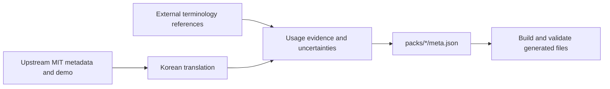

# Korean terminology sources and review status

This register covers all 192 Korean entries in the eight existing packs. The English names and demo definitions come from the [upstream MIT source](https://github.com/showheyohtaki/motion-prompt/blob/7819d3879eb7d5a1475c11c001bedffb5cab64af/LICENSE). External references were checked on 2026-10-30 to distinguish documented Korean terms from concept references and unresolved wording. A reference to a programming primitive does not establish the name of a complete visual effect.

| Status | Meaning | Entries |
|---|---|---:|
| K | The Korean term is used in the cited source; spacing or descriptive suffixes may differ. This is evidence of usage, not a claim that it is the sole industry standard. | 31 |
| C | The cited source supports the English term, a related concept or an implementation primitive. The chosen Korean spelling still needs usage review. | 64 |
| U | The upstream entry supplies the definition; independent Korean usage has not been established. Reviewer input is requested. | 97 |

## Provenance and materials

The Korean descriptions and prompts are AI-assisted translations and original adaptations of the upstream English/Japanese metadata. Numerical specifications preserve that metadata; automated translation checks do not independently verify every number against the demos. External references are used to identify terms and concepts; their paragraphs, example code, screenshots, videos and fonts are not incorporated into this contribution. The upstream copyright headers, MIT license and third-party notices remain in place. New Korean text uses installed system fonts; no font files or new media are included.

## Choices needing attention

- #181 uses **버드아이 뷰** after comparison with the Korean camera guide [S1]. Only the Korean contribution draft changes; upstream IDs and published names are preserved.
- #020, #024, #081, #084, #136, #154, #156, #157 and #165 retain their English source names. Their Korean meanings remain available. A missing Korean usage source is not a reason to invent a replacement name.
- Every C and U row is explicitly open to terminology review. The nine retained names are not the entire set of uncertain Korean wording.
- #060, #112, #124 and #134 have alternate vendor translations, identified in their rows. A related vendor label is not treated as proof of the current spelling.
- #173 retains the upstream name Steadicam. Its generic use as a technique name has not been independently established here; the contribution introduces no new brand name or logo.

## Name by name evidence

Each row links the fixed upstream metadata used for its definition. Source codes link to the external references below. Review the Korean name together with its meaning and request example in the pack metadata.

### motion

| ID | English | Korean | Status | Sources | Review note |
|---|---|---|:---:|---|---|
| 001 | Pop-in | 팝 인 | U | [upstream](https://github.com/showheyohtaki/motion-prompt/blob/7819d3879eb7d5a1475c11c001bedffb5cab64af/packs/motion/meta.json) | Korean draft; independent usage review requested. |
| 002 | Stagger | 스태거 | C | [upstream](https://github.com/showheyohtaki/motion-prompt/blob/7819d3879eb7d5a1475c11c001bedffb5cab64af/packs/motion/meta.json), [S5] | See status definition. |
| 003 | Burst | 버스트 | U | [upstream](https://github.com/showheyohtaki/motion-prompt/blob/7819d3879eb7d5a1475c11c001bedffb5cab64af/packs/motion/meta.json) | Korean draft; independent usage review requested. |
| 004 | Line draw | 라인 드로잉 | U | [upstream](https://github.com/showheyohtaki/motion-prompt/blob/7819d3879eb7d5a1475c11c001bedffb5cab64af/packs/motion/meta.json) | Korean draft; independent usage review requested. |
| 005 | Mask reveal | 마스크 리빌 | C | [upstream](https://github.com/showheyohtaki/motion-prompt/blob/7819d3879eb7d5a1475c11c001bedffb5cab64af/packs/motion/meta.json), [S7] | Mask concept; compound Korean effect name remains a draft. |
| 006 | Typewriter | 타이프라이터 | C | [upstream](https://github.com/showheyohtaki/motion-prompt/blob/7819d3879eb7d5a1475c11c001bedffb5cab64af/packs/motion/meta.json), [S37] | Related vendor effect: 타자기. Current wording needs review. |
| 007 | Count-up | 카운트 업 | U | [upstream](https://github.com/showheyohtaki/motion-prompt/blob/7819d3879eb7d5a1475c11c001bedffb5cab64af/packs/motion/meta.json) | Korean draft; independent usage review requested. |
| 008 | Kinetic typography | 키네틱 타이포그래피 | K | [upstream](https://github.com/showheyohtaki/motion-prompt/blob/7819d3879eb7d5a1475c11c001bedffb5cab64af/packs/motion/meta.json), [S36] | See status definition. |
| 009 | Easing | 이징 | C | [upstream](https://github.com/showheyohtaki/motion-prompt/blob/7819d3879eb7d5a1475c11c001bedffb5cab64af/packs/motion/meta.json), [S18] | Easing/back/bounce behavior; Korean wording needs usage review. |
| 010 | Overshoot | 오버슈트 | C | [upstream](https://github.com/showheyohtaki/motion-prompt/blob/7819d3879eb7d5a1475c11c001bedffb5cab64af/packs/motion/meta.json), [S18] | Easing/back/bounce behavior; Korean wording needs usage review. |
| 011 | Squash & stretch | 스쿼시 앤 스트레치 | C | [upstream](https://github.com/showheyohtaki/motion-prompt/blob/7819d3879eb7d5a1475c11c001bedffb5cab64af/packs/motion/meta.json), [S21] | See status definition. |
| 012 | Shape morph | 셰이프 모핑 | U | [upstream](https://github.com/showheyohtaki/motion-prompt/blob/7819d3879eb7d5a1475c11c001bedffb5cab64af/packs/motion/meta.json) | Korean draft; independent usage review requested. |
| 013 | Liquid motion | 리퀴드 모션 | U | [upstream](https://github.com/showheyohtaki/motion-prompt/blob/7819d3879eb7d5a1475c11c001bedffb5cab64af/packs/motion/meta.json) | Korean draft; independent usage review requested. |
| 014 | Motion trail | 모션 트레일 | U | [upstream](https://github.com/showheyohtaki/motion-prompt/blob/7819d3879eb7d5a1475c11c001bedffb5cab64af/packs/motion/meta.json) | Korean draft; independent usage review requested. |
| 015 | Particles | 파티클 | U | [upstream](https://github.com/showheyohtaki/motion-prompt/blob/7819d3879eb7d5a1475c11c001bedffb5cab64af/packs/motion/meta.json) | Korean draft; independent usage review requested. |
| 016 | Parallax | 패럴랙스 | U | [upstream](https://github.com/showheyohtaki/motion-prompt/blob/7819d3879eb7d5a1475c11c001bedffb5cab64af/packs/motion/meta.json) | Korean draft; independent usage review requested. |
| 017 | Mask transition | 마스크 전환 | C | [upstream](https://github.com/showheyohtaki/motion-prompt/blob/7819d3879eb7d5a1475c11c001bedffb5cab64af/packs/motion/meta.json), [S7] | Mask concept; compound Korean effect name remains a draft. |
| 018 | Shape transition | 도형 전환 | U | [upstream](https://github.com/showheyohtaki/motion-prompt/blob/7819d3879eb7d5a1475c11c001bedffb5cab64af/packs/motion/meta.json) | Korean draft; independent usage review requested. |
| 019 | Liquid transition | 리퀴드 전환 | U | [upstream](https://github.com/showheyohtaki/motion-prompt/blob/7819d3879eb7d5a1475c11c001bedffb5cab64af/packs/motion/meta.json) | Korean draft; independent usage review requested. |
| 020 | Zoom through | Zoom through | U | [upstream](https://github.com/showheyohtaki/motion-prompt/blob/7819d3879eb7d5a1475c11c001bedffb5cab64af/packs/motion/meta.json) | English source name retained; Korean usage unverified. |
| 021 | Flip | 플립 | C | [upstream](https://github.com/showheyohtaki/motion-prompt/blob/7819d3879eb7d5a1475c11c001bedffb5cab64af/packs/motion/meta.json), [S33] | Transform primitive only; not evidence for the complete effect name. |
| 022 | Light sweep | 라이트 스윕 | C | [upstream](https://github.com/showheyohtaki/motion-prompt/blob/7819d3879eb7d5a1475c11c001bedffb5cab64af/packs/motion/meta.json), [S37] | Related vendor effect: 조명 스윕. Current wording needs review. |
| 023 | Glitch | 글리치 | K | [upstream](https://github.com/showheyohtaki/motion-prompt/blob/7819d3879eb7d5a1475c11c001bedffb5cab64af/packs/motion/meta.json), [S22] | Korean source uses 글리치 효과. |
| 024 | Impact shake | Impact shake | U | [upstream](https://github.com/showheyohtaki/motion-prompt/blob/7819d3879eb7d5a1475c11c001bedffb5cab64af/packs/motion/meta.json) | English source name retained; Korean usage unverified. |

### camera

| ID | English | Korean | Status | Sources | Review note |
|---|---|---|:---:|---|---|
| 025 | Pan | 팬 | C | [upstream](https://github.com/showheyohtaki/motion-prompt/blob/7819d3879eb7d5a1475c11c001bedffb5cab64af/packs/camera/meta.json), [S1] | Pan/tilt/zoom concept; full chosen Korean label not independently established. |
| 026 | Tilt | 틸트 | C | [upstream](https://github.com/showheyohtaki/motion-prompt/blob/7819d3879eb7d5a1475c11c001bedffb5cab64af/packs/camera/meta.json), [S1] | Pan/tilt/zoom concept; full chosen Korean label not independently established. |
| 027 | Dolly in | 돌리 인 | K | [upstream](https://github.com/showheyohtaki/motion-prompt/blob/7819d3879eb7d5a1475c11c001bedffb5cab64af/packs/camera/meta.json), [S1] | Korean term appears in source; spacing and explanatory suffixes may differ. |
| 028 | Zoom in | 줌 인 | C | [upstream](https://github.com/showheyohtaki/motion-prompt/blob/7819d3879eb7d5a1475c11c001bedffb5cab64af/packs/camera/meta.json), [S1] | Pan/tilt/zoom concept; full chosen Korean label not independently established. |
| 029 | Tracking shot | 트래킹 샷 | K | [upstream](https://github.com/showheyohtaki/motion-prompt/blob/7819d3879eb7d5a1475c11c001bedffb5cab64af/packs/camera/meta.json), [S1] | Korean term appears in source; spacing and explanatory suffixes may differ. |
| 030 | Orbit (Arc shot) | 오빗 샷(아크 샷) | U | [upstream](https://github.com/showheyohtaki/motion-prompt/blob/7819d3879eb7d5a1475c11c001bedffb5cab64af/packs/camera/meta.json) | Korean draft; independent usage review requested. |
| 031 | Crane up | 크레인 업 | U | [upstream](https://github.com/showheyohtaki/motion-prompt/blob/7819d3879eb7d5a1475c11c001bedffb5cab64af/packs/camera/meta.json) | Korean draft; independent usage review requested. |
| 032 | Dolly zoom (Vertigo) | 돌리 줌(버티고 효과) | K | [upstream](https://github.com/showheyohtaki/motion-prompt/blob/7819d3879eb7d5a1475c11c001bedffb5cab64af/packs/camera/meta.json), [S1] | Korean term appears in source; spacing and explanatory suffixes may differ. |
| 033 | Rack focus | 랙 포커스 | U | [upstream](https://github.com/showheyohtaki/motion-prompt/blob/7819d3879eb7d5a1475c11c001bedffb5cab64af/packs/camera/meta.json) | Korean draft; independent usage review requested. |
| 034 | Handheld | 핸드헬드 | K | [upstream](https://github.com/showheyohtaki/motion-prompt/blob/7819d3879eb7d5a1475c11c001bedffb5cab64af/packs/camera/meta.json), [S1] | Korean term appears in source; spacing and explanatory suffixes may differ. |
| 035 | FPV drone shot | FPV 드론 샷 | U | [upstream](https://github.com/showheyohtaki/motion-prompt/blob/7819d3879eb7d5a1475c11c001bedffb5cab64af/packs/camera/meta.json) | Korean draft; independent usage review requested. |
| 036 | Dutch angle | 더치 앵글 | K | [upstream](https://github.com/showheyohtaki/motion-prompt/blob/7819d3879eb7d5a1475c11c001bedffb5cab64af/packs/camera/meta.json), [S1] | Korean term appears in source; spacing and explanatory suffixes may differ. |
| 037 | Slow motion | 슬로 모션 | U | [upstream](https://github.com/showheyohtaki/motion-prompt/blob/7819d3879eb7d5a1475c11c001bedffb5cab64af/packs/camera/meta.json) | Korean draft; independent usage review requested. |
| 038 | Speed ramp | 스피드 램프 | U | [upstream](https://github.com/showheyohtaki/motion-prompt/blob/7819d3879eb7d5a1475c11c001bedffb5cab64af/packs/camera/meta.json) | Korean draft; independent usage review requested. |
| 039 | Time-lapse | 타임랩스 | U | [upstream](https://github.com/showheyohtaki/motion-prompt/blob/7819d3879eb7d5a1475c11c001bedffb5cab64af/packs/camera/meta.json) | Korean draft; independent usage review requested. |
| 040 | Freeze frame | 프리즈 프레임 | U | [upstream](https://github.com/showheyohtaki/motion-prompt/blob/7819d3879eb7d5a1475c11c001bedffb5cab64af/packs/camera/meta.json) | Korean draft; independent usage review requested. |
| 041 | Jump cut | 점프 컷 | U | [upstream](https://github.com/showheyohtaki/motion-prompt/blob/7819d3879eb7d5a1475c11c001bedffb5cab64af/packs/camera/meta.json) | Korean draft; independent usage review requested. |
| 042 | Match cut | 매치 컷 | U | [upstream](https://github.com/showheyohtaki/motion-prompt/blob/7819d3879eb7d5a1475c11c001bedffb5cab64af/packs/camera/meta.json) | Korean draft; independent usage review requested. |
| 043 | Whip pan | 휩 팬 | U | [upstream](https://github.com/showheyohtaki/motion-prompt/blob/7819d3879eb7d5a1475c11c001bedffb5cab64af/packs/camera/meta.json) | Korean draft; independent usage review requested. |
| 044 | Cross dissolve | 크로스 디졸브 | U | [upstream](https://github.com/showheyohtaki/motion-prompt/blob/7819d3879eb7d5a1475c11c001bedffb5cab64af/packs/camera/meta.json) | Korean draft; independent usage review requested. |
| 045 | Wipe | 와이프 | U | [upstream](https://github.com/showheyohtaki/motion-prompt/blob/7819d3879eb7d5a1475c11c001bedffb5cab64af/packs/camera/meta.json) | Korean draft; independent usage review requested. |
| 046 | Smash cut | 스매시 컷 | U | [upstream](https://github.com/showheyohtaki/motion-prompt/blob/7819d3879eb7d5a1475c11c001bedffb5cab64af/packs/camera/meta.json) | Korean draft; independent usage review requested. |
| 047 | J-cut | J컷 | K | [upstream](https://github.com/showheyohtaki/motion-prompt/blob/7819d3879eb7d5a1475c11c001bedffb5cab64af/packs/camera/meta.json), [S2] | See status definition. |
| 048 | L-cut | L컷 | K | [upstream](https://github.com/showheyohtaki/motion-prompt/blob/7819d3879eb7d5a1475c11c001bedffb5cab64af/packs/camera/meta.json), [S2] | See status definition. |

### ui

| ID | English | Korean | Status | Sources | Review note |
|---|---|---|:---:|---|---|
| 049 | Modal dialog | 모달 대화상자 | C | [upstream](https://github.com/showheyohtaki/motion-prompt/blob/7819d3879eb7d5a1475c11c001bedffb5cab64af/packs/ui/meta.json), [S4] | English widget term or equivalent behavior; Korean wording remains a draft. |
| 050 | Drawer (Off-canvas) | 드로어(오프캔버스) | C | [upstream](https://github.com/showheyohtaki/motion-prompt/blob/7819d3879eb7d5a1475c11c001bedffb5cab64af/packs/ui/meta.json), [S24] | See status definition. |
| 051 | Bottom sheet | 바텀 시트 | K | [upstream](https://github.com/showheyohtaki/motion-prompt/blob/7819d3879eb7d5a1475c11c001bedffb5cab64af/packs/ui/meta.json), [S3] | See status definition. |
| 052 | Accordion | 아코디언 | C | [upstream](https://github.com/showheyohtaki/motion-prompt/blob/7819d3879eb7d5a1475c11c001bedffb5cab64af/packs/ui/meta.json), [S4] | English widget term or equivalent behavior; Korean wording remains a draft. |
| 053 | Dropdown (select) | 드롭다운(선택 목록) | C | [upstream](https://github.com/showheyohtaki/motion-prompt/blob/7819d3879eb7d5a1475c11c001bedffb5cab64af/packs/ui/meta.json), [S4] | English widget term or equivalent behavior; Korean wording remains a draft. |
| 054 | Tooltip | 툴팁 | C | [upstream](https://github.com/showheyohtaki/motion-prompt/blob/7819d3879eb7d5a1475c11c001bedffb5cab64af/packs/ui/meta.json), [S4] | English widget term or equivalent behavior; Korean wording remains a draft. |
| 055 | Popover | 팝오버 | C | [upstream](https://github.com/showheyohtaki/motion-prompt/blob/7819d3879eb7d5a1475c11c001bedffb5cab64af/packs/ui/meta.json), [S25] | See status definition. |
| 056 | Toast notification | 토스트 알림 | C | [upstream](https://github.com/showheyohtaki/motion-prompt/blob/7819d3879eb7d5a1475c11c001bedffb5cab64af/packs/ui/meta.json), [S31] | See status definition. |
| 057 | Tabs | 탭 | C | [upstream](https://github.com/showheyohtaki/motion-prompt/blob/7819d3879eb7d5a1475c11c001bedffb5cab64af/packs/ui/meta.json), [S4] | English widget term or equivalent behavior; Korean wording remains a draft. |
| 058 | Carousel | 캐러셀 | K | [upstream](https://github.com/showheyohtaki/motion-prompt/blob/7819d3879eb7d5a1475c11c001bedffb5cab64af/packs/ui/meta.json), [S3] | See status definition. |
| 059 | Toggle switch | 토글 스위치 | C | [upstream](https://github.com/showheyohtaki/motion-prompt/blob/7819d3879eb7d5a1475c11c001bedffb5cab64af/packs/ui/meta.json), [S4] | English widget term or equivalent behavior; Korean wording remains a draft. |
| 060 | Segmented control | 세그먼티드 컨트롤 | C | [upstream](https://github.com/showheyohtaki/motion-prompt/blob/7819d3879eb7d5a1475c11c001bedffb5cab64af/packs/ui/meta.json), [S3] | Material terminology varies; source does not settle this exact Korean label. |
| 061 | Filter chips | 필터 칩 | C | [upstream](https://github.com/showheyohtaki/motion-prompt/blob/7819d3879eb7d5a1475c11c001bedffb5cab64af/packs/ui/meta.json), [S3] | Material terminology varies; source does not settle this exact Korean label. |
| 062 | Range slider | 범위 슬라이더 | C | [upstream](https://github.com/showheyohtaki/motion-prompt/blob/7819d3879eb7d5a1475c11c001bedffb5cab64af/packs/ui/meta.json), [S4] | English widget term or equivalent behavior; Korean wording remains a draft. |
| 063 | Stepper (+/−) | 스테퍼(+/−) | C | [upstream](https://github.com/showheyohtaki/motion-prompt/blob/7819d3879eb7d5a1475c11c001bedffb5cab64af/packs/ui/meta.json), [S4] | English widget term or equivalent behavior; Korean wording remains a draft. |
| 064 | Pagination | 페이지네이션 | C | [upstream](https://github.com/showheyohtaki/motion-prompt/blob/7819d3879eb7d5a1475c11c001bedffb5cab64af/packs/ui/meta.json), [S29] | See status definition. |
| 065 | Hamburger menu | 햄버거 메뉴 | U | [upstream](https://github.com/showheyohtaki/motion-prompt/blob/7819d3879eb7d5a1475c11c001bedffb5cab64af/packs/ui/meta.json) | Korean draft; independent usage review requested. |
| 066 | Breadcrumbs | 브레드크럼 | C | [upstream](https://github.com/showheyohtaki/motion-prompt/blob/7819d3879eb7d5a1475c11c001bedffb5cab64af/packs/ui/meta.json), [S4] | English widget term or equivalent behavior; Korean wording remains a draft. |
| 067 | Mega menu | 메가 메뉴 | U | [upstream](https://github.com/showheyohtaki/motion-prompt/blob/7819d3879eb7d5a1475c11c001bedffb5cab64af/packs/ui/meta.json) | Korean draft; independent usage review requested. |
| 068 | Step indicator | 단계 표시기 | U | [upstream](https://github.com/showheyohtaki/motion-prompt/blob/7819d3879eb7d5a1475c11c001bedffb5cab64af/packs/ui/meta.json) | Korean draft; independent usage review requested. |
| 069 | Skeleton screen | 스켈레톤 화면 | U | [upstream](https://github.com/showheyohtaki/motion-prompt/blob/7819d3879eb7d5a1475c11c001bedffb5cab64af/packs/ui/meta.json) | Korean draft; independent usage review requested. |
| 070 | Spinner | 스피너 | C | [upstream](https://github.com/showheyohtaki/motion-prompt/blob/7819d3879eb7d5a1475c11c001bedffb5cab64af/packs/ui/meta.json), [S30] | See status definition. |
| 071 | Badge | 배지 | K | [upstream](https://github.com/showheyohtaki/motion-prompt/blob/7819d3879eb7d5a1475c11c001bedffb5cab64af/packs/ui/meta.json), [S3] | See status definition. |
| 072 | Empty state | 빈 상태 | U | [upstream](https://github.com/showheyohtaki/motion-prompt/blob/7819d3879eb7d5a1475c11c001bedffb5cab64af/packs/ui/meta.json) | Korean draft; independent usage review requested. |

### lp

| ID | English | Korean | Status | Sources | Review note |
|---|---|---|:---:|---|---|
| 073 | Parallax scrolling | 패럴랙스 스크롤 | U | [upstream](https://github.com/showheyohtaki/motion-prompt/blob/7819d3879eb7d5a1475c11c001bedffb5cab64af/packs/lp/meta.json) | Korean draft; independent usage review requested. |
| 074 | Fade-in on scroll | 스크롤 페이드 인 | U | [upstream](https://github.com/showheyohtaki/motion-prompt/blob/7819d3879eb7d5a1475c11c001bedffb5cab64af/packs/lp/meta.json) | Korean draft; independent usage review requested. |
| 075 | Sticky header | 스티키 헤더 | C | [upstream](https://github.com/showheyohtaki/motion-prompt/blob/7819d3879eb7d5a1475c11c001bedffb5cab64af/packs/lp/meta.json), [S14] | See status definition. |
| 076 | Pinning | 피닝 | C | [upstream](https://github.com/showheyohtaki/motion-prompt/blob/7819d3879eb7d5a1475c11c001bedffb5cab64af/packs/lp/meta.json), [S9] | Pin/progress/scroll linkage; not proof of a standard Korean effect name. |
| 077 | Horizontal scroll | 가로 스크롤 | U | [upstream](https://github.com/showheyohtaki/motion-prompt/blob/7819d3879eb7d5a1475c11c001bedffb5cab64af/packs/lp/meta.json) | Korean draft; independent usage review requested. |
| 078 | Scroll snap | 스크롤 스냅 | C | [upstream](https://github.com/showheyohtaki/motion-prompt/blob/7819d3879eb7d5a1475c11c001bedffb5cab64af/packs/lp/meta.json), [S10] | See status definition. |
| 079 | Scroll progress bar | 스크롤 진행률 표시줄 | C | [upstream](https://github.com/showheyohtaki/motion-prompt/blob/7819d3879eb7d5a1475c11c001bedffb5cab64af/packs/lp/meta.json), [S9] | Pin/progress/scroll linkage; not proof of a standard Korean effect name. |
| 080 | Highlighter animation | 형광펜 애니메이션 | U | [upstream](https://github.com/showheyohtaki/motion-prompt/blob/7819d3879eb7d5a1475c11c001bedffb5cab64af/packs/lp/meta.json) | Korean draft; independent usage review requested. |
| 081 | Hover lift | Hover lift | U | [upstream](https://github.com/showheyohtaki/motion-prompt/blob/7819d3879eb7d5a1475c11c001bedffb5cab64af/packs/lp/meta.json) | English source name retained; Korean usage unverified. |
| 082 | Image zoom on hover | 호버 이미지 확대 | C | [upstream](https://github.com/showheyohtaki/motion-prompt/blob/7819d3879eb7d5a1475c11c001bedffb5cab64af/packs/lp/meta.json), [S33] | Transform primitive only; not evidence for the complete effect name. |
| 083 | Cursor follower | 커서 팔로워 | U | [upstream](https://github.com/showheyohtaki/motion-prompt/blob/7819d3879eb7d5a1475c11c001bedffb5cab64af/packs/lp/meta.json) | Korean draft; independent usage review requested. |
| 084 | Magnetic button | Magnetic button | U | [upstream](https://github.com/showheyohtaki/motion-prompt/blob/7819d3879eb7d5a1475c11c001bedffb5cab64af/packs/lp/meta.json) | English source name retained; Korean usage unverified. |
| 085 | Ripple effect | 리플 효과 | U | [upstream](https://github.com/showheyohtaki/motion-prompt/blob/7819d3879eb7d5a1475c11c001bedffb5cab64af/packs/lp/meta.json) | Korean draft; independent usage review requested. |
| 086 | Underline animation | 밑줄 애니메이션 | U | [upstream](https://github.com/showheyohtaki/motion-prompt/blob/7819d3879eb7d5a1475c11c001bedffb5cab64af/packs/lp/meta.json) | Korean draft; independent usage review requested. |
| 087 | Before/after slider | 전후 비교 슬라이더 | U | [upstream](https://github.com/showheyohtaki/motion-prompt/blob/7819d3879eb7d5a1475c11c001bedffb5cab64af/packs/lp/meta.json) | Korean draft; independent usage review requested. |
| 088 | Exit-intent popup | 이탈 의도 팝업 | U | [upstream](https://github.com/showheyohtaki/motion-prompt/blob/7819d3879eb7d5a1475c11c001bedffb5cab64af/packs/lp/meta.json) | Korean draft; independent usage review requested. |
| 089 | Preloader | 프리로더 | U | [upstream](https://github.com/showheyohtaki/motion-prompt/blob/7819d3879eb7d5a1475c11c001bedffb5cab64af/packs/lp/meta.json) | Korean draft; independent usage review requested. |
| 090 | Lazy loading | 지연 로딩 | C | [upstream](https://github.com/showheyohtaki/motion-prompt/blob/7819d3879eb7d5a1475c11c001bedffb5cab64af/packs/lp/meta.json), [S15] | See status definition. |
| 091 | Infinite scroll | 무한 스크롤 | U | [upstream](https://github.com/showheyohtaki/motion-prompt/blob/7819d3879eb7d5a1475c11c001bedffb5cab64af/packs/lp/meta.json) | Korean draft; independent usage review requested. |
| 092 | Page transition | 페이지 전환 | C | [upstream](https://github.com/showheyohtaki/motion-prompt/blob/7819d3879eb7d5a1475c11c001bedffb5cab64af/packs/lp/meta.json), [S16] | See status definition. |
| 093 | Smooth scroll | 부드러운 스크롤 | C | [upstream](https://github.com/showheyohtaki/motion-prompt/blob/7819d3879eb7d5a1475c11c001bedffb5cab64af/packs/lp/meta.json), [S20] | Scrolling behavior only; Korean label needs usage review. |
| 094 | Marquee | 마키 | U | [upstream](https://github.com/showheyohtaki/motion-prompt/blob/7819d3879eb7d5a1475c11c001bedffb5cab64af/packs/lp/meta.json) | Korean draft; independent usage review requested. |
| 095 | Animated gradient | 그라디언트 애니메이션 | U | [upstream](https://github.com/showheyohtaki/motion-prompt/blob/7819d3879eb7d5a1475c11c001bedffb5cab64af/packs/lp/meta.json) | Korean draft; independent usage review requested. |
| 096 | Floating animation | 플로팅 애니메이션 | U | [upstream](https://github.com/showheyohtaki/motion-prompt/blob/7819d3879eb7d5a1475c11c001bedffb5cab64af/packs/lp/meta.json) | Korean draft; independent usage review requested. |

### photo

| ID | English | Korean | Status | Sources | Review note |
|---|---|---|:---:|---|---|
| 097 | Backlighting | 역광 | K | [upstream](https://github.com/showheyohtaki/motion-prompt/blob/7819d3879eb7d5a1475c11c001bedffb5cab64af/packs/photo/meta.json), [S11] | Korean source uses 역광, 실루엣, 렘브란트 조명 and 하이키. |
| 098 | Rim light | 림 라이트 | U | [upstream](https://github.com/showheyohtaki/motion-prompt/blob/7819d3879eb7d5a1475c11c001bedffb5cab64af/packs/photo/meta.json) | Korean draft; independent usage review requested. |
| 099 | Silhouette | 실루엣 | K | [upstream](https://github.com/showheyohtaki/motion-prompt/blob/7819d3879eb7d5a1475c11c001bedffb5cab64af/packs/photo/meta.json), [S11] | Korean source uses 역광, 실루엣, 렘브란트 조명 and 하이키. |
| 100 | Split lighting | 스플릿 조명 | U | [upstream](https://github.com/showheyohtaki/motion-prompt/blob/7819d3879eb7d5a1475c11c001bedffb5cab64af/packs/photo/meta.json) | Korean draft; independent usage review requested. |
| 101 | Rembrandt lighting | 렘브란트 조명 | K | [upstream](https://github.com/showheyohtaki/motion-prompt/blob/7819d3879eb7d5a1475c11c001bedffb5cab64af/packs/photo/meta.json), [S11] | Korean source uses 역광, 실루엣, 렘브란트 조명 and 하이키. |
| 102 | Butterfly lighting | 버터플라이 조명 | U | [upstream](https://github.com/showheyohtaki/motion-prompt/blob/7819d3879eb7d5a1475c11c001bedffb5cab64af/packs/photo/meta.json) | Korean draft; independent usage review requested. |
| 103 | Golden hour | 골든 아워 | K | [upstream](https://github.com/showheyohtaki/motion-prompt/blob/7819d3879eb7d5a1475c11c001bedffb5cab64af/packs/photo/meta.json), [S23] | See status definition. |
| 104 | Blue hour | 블루 아워 | K | [upstream](https://github.com/showheyohtaki/motion-prompt/blob/7819d3879eb7d5a1475c11c001bedffb5cab64af/packs/photo/meta.json), [S23] | See status definition. |
| 105 | Bokeh | 보케 | K | [upstream](https://github.com/showheyohtaki/motion-prompt/blob/7819d3879eb7d5a1475c11c001bedffb5cab64af/packs/photo/meta.json), [S13] | See status definition. |
| 106 | Tilt-shift | 틸트 시프트 | U | [upstream](https://github.com/showheyohtaki/motion-prompt/blob/7819d3879eb7d5a1475c11c001bedffb5cab64af/packs/photo/meta.json) | Korean draft; independent usage review requested. |
| 107 | Long exposure | 장노출 | U | [upstream](https://github.com/showheyohtaki/motion-prompt/blob/7819d3879eb7d5a1475c11c001bedffb5cab64af/packs/photo/meta.json) | Korean draft; independent usage review requested. |
| 108 | Panning shot | 패닝 샷 | U | [upstream](https://github.com/showheyohtaki/motion-prompt/blob/7819d3879eb7d5a1475c11c001bedffb5cab64af/packs/photo/meta.json) | Korean draft; independent usage review requested. |
| 109 | Lens flare | 렌즈 플레어 | K | [upstream](https://github.com/showheyohtaki/motion-prompt/blob/7819d3879eb7d5a1475c11c001bedffb5cab64af/packs/photo/meta.json), [S12] | See status definition. |
| 110 | Fisheye lens | 어안 렌즈 | U | [upstream](https://github.com/showheyohtaki/motion-prompt/blob/7819d3879eb7d5a1475c11c001bedffb5cab64af/packs/photo/meta.json) | Korean draft; independent usage review requested. |
| 111 | Chromatic aberration | 색수차 | K | [upstream](https://github.com/showheyohtaki/motion-prompt/blob/7819d3879eb7d5a1475c11c001bedffb5cab64af/packs/photo/meta.json), [S22] | See status definition. |
| 112 | Vignette | 비네트 | C | [upstream](https://github.com/showheyohtaki/motion-prompt/blob/7819d3879eb7d5a1475c11c001bedffb5cab64af/packs/photo/meta.json), [S22] | Source uses 비네팅; current draft uses 비네트. Usage choice remains open. |
| 113 | High-key | 하이 키 | K | [upstream](https://github.com/showheyohtaki/motion-prompt/blob/7819d3879eb7d5a1475c11c001bedffb5cab64af/packs/photo/meta.json), [S11] | Korean source uses 역광, 실루엣, 렘브란트 조명 and 하이키. |
| 114 | Low-key | 로우 키 | U | [upstream](https://github.com/showheyohtaki/motion-prompt/blob/7819d3879eb7d5a1475c11c001bedffb5cab64af/packs/photo/meta.json) | Korean draft; independent usage review requested. |
| 115 | Black and white | 흑백 | U | [upstream](https://github.com/showheyohtaki/motion-prompt/blob/7819d3879eb7d5a1475c11c001bedffb5cab64af/packs/photo/meta.json) | Korean draft; independent usage review requested. |
| 116 | Duotone | 듀오톤 | U | [upstream](https://github.com/showheyohtaki/motion-prompt/blob/7819d3879eb7d5a1475c11c001bedffb5cab64af/packs/photo/meta.json) | Korean draft; independent usage review requested. |
| 117 | Teal and orange | 틸 앤 오렌지 | U | [upstream](https://github.com/showheyohtaki/motion-prompt/blob/7819d3879eb7d5a1475c11c001bedffb5cab64af/packs/photo/meta.json) | Korean draft; independent usage review requested. |
| 118 | Film grain | 필름 그레인 | U | [upstream](https://github.com/showheyohtaki/motion-prompt/blob/7819d3879eb7d5a1475c11c001bedffb5cab64af/packs/photo/meta.json) | Korean draft; independent usage review requested. |
| 119 | Light leak | 빛샘 | C | [upstream](https://github.com/showheyohtaki/motion-prompt/blob/7819d3879eb7d5a1475c11c001bedffb5cab64af/packs/photo/meta.json), [S37] | Related vendor effect: 조명 누출. Current wording needs review. |
| 120 | Double exposure | 이중 노출 | U | [upstream](https://github.com/showheyohtaki/motion-prompt/blob/7819d3879eb7d5a1475c11c001bedffb5cab64af/packs/photo/meta.json) | Korean draft; independent usage review requested. |

### motion2

| ID | English | Korean | Status | Sources | Review note |
|---|---|---|:---:|---|---|
| 121 | Anticipation | 예비 동작 | C | [upstream](https://github.com/showheyohtaki/motion-prompt/blob/7819d3879eb7d5a1475c11c001bedffb5cab64af/packs/motion2/meta.json), [S21] | See status definition. |
| 122 | Follow-through | 팔로우 스루(후속 동작) | C | [upstream](https://github.com/showheyohtaki/motion-prompt/blob/7819d3879eb7d5a1475c11c001bedffb5cab64af/packs/motion2/meta.json), [S21] | See status definition. |
| 123 | Bounce | 바운스 | C | [upstream](https://github.com/showheyohtaki/motion-prompt/blob/7819d3879eb7d5a1475c11c001bedffb5cab64af/packs/motion2/meta.json), [S18] | Easing/back/bounce behavior; Korean wording needs usage review. |
| 124 | Wiggle | 위글 | C | [upstream](https://github.com/showheyohtaki/motion-prompt/blob/7819d3879eb7d5a1475c11c001bedffb5cab64af/packs/motion2/meta.json), [S8] | Source uses 흔들기/반복; it does not establish 위글/리피터 spelling. |
| 125 | Pulse | 펄스 | U | [upstream](https://github.com/showheyohtaki/motion-prompt/blob/7819d3879eb7d5a1475c11c001bedffb5cab64af/packs/motion2/meta.json) | Korean draft; independent usage review requested. |
| 126 | Motion path | 모션 패스 | K | [upstream](https://github.com/showheyohtaki/motion-prompt/blob/7819d3879eb7d5a1475c11c001bedffb5cab64af/packs/motion2/meta.json), [S7], [S19] | Adobe Korean source includes 모션 패스; GSAP supplies the path concept. |
| 127 | Ping-pong loop | 핑퐁 루프 | C | [upstream](https://github.com/showheyohtaki/motion-prompt/blob/7819d3879eb7d5a1475c11c001bedffb5cab64af/packs/motion2/meta.json), [S28] | Yoyo/repeat behavior; not independent evidence for 핑퐁 루프. |
| 128 | Stop-motion style | 스톱 모션 스타일 | U | [upstream](https://github.com/showheyohtaki/motion-prompt/blob/7819d3879eb7d5a1475c11c001bedffb5cab64af/packs/motion2/meta.json) | Korean draft; independent usage review requested. |
| 129 | Text scramble | 텍스트 스크램블 | C | [upstream](https://github.com/showheyohtaki/motion-prompt/blob/7819d3879eb7d5a1475c11c001bedffb5cab64af/packs/motion2/meta.json), [S6] | See status definition. |
| 130 | Wave text | 웨이브 텍스트 | U | [upstream](https://github.com/showheyohtaki/motion-prompt/blob/7819d3879eb7d5a1475c11c001bedffb5cab64af/packs/motion2/meta.json) | Korean draft; independent usage review requested. |
| 131 | Text on a path | 패스 위의 텍스트 | C | [upstream](https://github.com/showheyohtaki/motion-prompt/blob/7819d3879eb7d5a1475c11c001bedffb5cab64af/packs/motion2/meta.json), [S32] | See status definition. |
| 132 | Variable font animation | 가변 글꼴 애니메이션 | C | [upstream](https://github.com/showheyohtaki/motion-prompt/blob/7819d3879eb7d5a1475c11c001bedffb5cab64af/packs/motion2/meta.json), [S17] | See status definition. |
| 133 | Text mask | 텍스트 마스크 | C | [upstream](https://github.com/showheyohtaki/motion-prompt/blob/7819d3879eb7d5a1475c11c001bedffb5cab64af/packs/motion2/meta.json), [S7] | Mask concept; compound Korean effect name remains a draft. |
| 134 | Repeater | 리피터 | C | [upstream](https://github.com/showheyohtaki/motion-prompt/blob/7819d3879eb7d5a1475c11c001bedffb5cab64af/packs/motion2/meta.json), [S8] | Source uses 흔들기/반복; it does not establish 위글/리피터 spelling. |
| 135 | Kaleidoscope | 만화경 | K | [upstream](https://github.com/showheyohtaki/motion-prompt/blob/7819d3879eb7d5a1475c11c001bedffb5cab64af/packs/motion2/meta.json), [S37] | Source lists 만화경 and 밀어내기; wording evidence, not equivalence of every effect setting. |
| 136 | Line boil | Line boil | U | [upstream](https://github.com/showheyohtaki/motion-prompt/blob/7819d3879eb7d5a1475c11c001bedffb5cab64af/packs/motion2/meta.json) | English source name retained; Korean usage unverified. |
| 137 | Push transition | 밀어내기 전환 | K | [upstream](https://github.com/showheyohtaki/motion-prompt/blob/7819d3879eb7d5a1475c11c001bedffb5cab64af/packs/motion2/meta.json), [S37] | Source lists 만화경 and 밀어내기; wording evidence, not equivalence of every effect setting. |
| 138 | Blinds transition | 블라인드 전환 | C | [upstream](https://github.com/showheyohtaki/motion-prompt/blob/7819d3879eb7d5a1475c11c001bedffb5cab64af/packs/motion2/meta.json), [S37] | Related vendor effect: 베니스식 차양. Current wording needs review. |
| 139 | Cube transition | 큐브 전환 | C | [upstream](https://github.com/showheyohtaki/motion-prompt/blob/7819d3879eb7d5a1475c11c001bedffb5cab64af/packs/motion2/meta.json), [S37] | Related vendor effect: 큐브 회전. Current wording needs review. |
| 140 | Page curl | 페이지 말림 | C | [upstream](https://github.com/showheyohtaki/motion-prompt/blob/7819d3879eb7d5a1475c11c001bedffb5cab64af/packs/motion2/meta.json), [S37] | Related vendor effect: 페이지 벗기기. Current wording needs review. |
| 141 | Pixelate | 픽셀화 | C | [upstream](https://github.com/showheyohtaki/motion-prompt/blob/7819d3879eb7d5a1475c11c001bedffb5cab64af/packs/motion2/meta.json), [S37] | Related vendor effect: 모자이크. Current wording needs review. |
| 142 | Shatter | 산산조각 | U | [upstream](https://github.com/showheyohtaki/motion-prompt/blob/7819d3879eb7d5a1475c11c001bedffb5cab64af/packs/motion2/meta.json) | Korean draft; independent usage review requested. |
| 143 | Exploded view | 분해도 | U | [upstream](https://github.com/showheyohtaki/motion-prompt/blob/7819d3879eb7d5a1475c11c001bedffb5cab64af/packs/motion2/meta.json) | Korean draft; independent usage review requested. |
| 144 | Split screen | 분할 화면 | U | [upstream](https://github.com/showheyohtaki/motion-prompt/blob/7819d3879eb7d5a1475c11c001bedffb5cab64af/packs/motion2/meta.json) | Korean draft; independent usage review requested. |

### lp2

| ID | English | Korean | Status | Sources | Review note |
|---|---|---|:---:|---|---|
| 145 | Timeline on scroll | 스크롤 타임라인 | C | [upstream](https://github.com/showheyohtaki/motion-prompt/blob/7819d3879eb7d5a1475c11c001bedffb5cab64af/packs/lp2/meta.json), [S9] | Pin/progress/scroll linkage; not proof of a standard Korean effect name. |
| 146 | Scroll text reveal | 스크롤 텍스트 리빌 | U | [upstream](https://github.com/showheyohtaki/motion-prompt/blob/7819d3879eb7d5a1475c11c001bedffb5cab64af/packs/lp2/meta.json) | Korean draft; independent usage review requested. |
| 147 | Stacking cards | 카드 쌓기 | U | [upstream](https://github.com/showheyohtaki/motion-prompt/blob/7819d3879eb7d5a1475c11c001bedffb5cab64af/packs/lp2/meta.json) | Korean draft; independent usage review requested. |
| 148 | Background color change on scroll | 스크롤 배경색 전환 | U | [upstream](https://github.com/showheyohtaki/motion-prompt/blob/7819d3879eb7d5a1475c11c001bedffb5cab64af/packs/lp2/meta.json) | Korean draft; independent usage review requested. |
| 149 | Hide-on-scroll header | 스크롤 시 숨기는 헤더 | U | [upstream](https://github.com/showheyohtaki/motion-prompt/blob/7819d3879eb7d5a1475c11c001bedffb5cab64af/packs/lp2/meta.json) | Korean draft; independent usage review requested. |
| 150 | Scrollspy | 스크롤스파이 | C | [upstream](https://github.com/showheyohtaki/motion-prompt/blob/7819d3879eb7d5a1475c11c001bedffb5cab64af/packs/lp2/meta.json), [S35] | See status definition. |
| 151 | Back-to-top button | 맨 위로 버튼 | C | [upstream](https://github.com/showheyohtaki/motion-prompt/blob/7819d3879eb7d5a1475c11c001bedffb5cab64af/packs/lp2/meta.json), [S20] | Scrolling behavior only; Korean label needs usage review. |
| 152 | Zoom on scroll | 스크롤 확대 | C | [upstream](https://github.com/showheyohtaki/motion-prompt/blob/7819d3879eb7d5a1475c11c001bedffb5cab64af/packs/lp2/meta.json), [S33] | Transform primitive only; not evidence for the complete effect name. |
| 153 | 3D tilt on hover | 호버 3D 틸트 | C | [upstream](https://github.com/showheyohtaki/motion-prompt/blob/7819d3879eb7d5a1475c11c001bedffb5cab64af/packs/lp2/meta.json), [S33] | Transform primitive only; not evidence for the complete effect name. |
| 154 | Spotlight hover | Spotlight hover | U | [upstream](https://github.com/showheyohtaki/motion-prompt/blob/7819d3879eb7d5a1475c11c001bedffb5cab64af/packs/lp2/meta.json) | English source name retained; Korean usage unverified. |
| 155 | Image swap on hover | 호버 이미지 교체 | U | [upstream](https://github.com/showheyohtaki/motion-prompt/blob/7819d3879eb7d5a1475c11c001bedffb5cab64af/packs/lp2/meta.json) | Korean draft; independent usage review requested. |
| 156 | Text roll on hover | Text roll on hover | U | [upstream](https://github.com/showheyohtaki/motion-prompt/blob/7819d3879eb7d5a1475c11c001bedffb5cab64af/packs/lp2/meta.json) | English source name retained; Korean usage unverified. |
| 157 | Hover image reveal | Hover image reveal | U | [upstream](https://github.com/showheyohtaki/motion-prompt/blob/7819d3879eb7d5a1475c11c001bedffb5cab64af/packs/lp2/meta.json) | English source name retained; Korean usage unverified. |
| 158 | Floating label | 플로팅 레이블 | C | [upstream](https://github.com/showheyohtaki/motion-prompt/blob/7819d3879eb7d5a1475c11c001bedffb5cab64af/packs/lp2/meta.json), [S26] | See status definition. |
| 159 | Inline validation | 인라인 유효성 검사 | C | [upstream](https://github.com/showheyohtaki/motion-prompt/blob/7819d3879eb7d5a1475c11c001bedffb5cab64af/packs/lp2/meta.json), [S27] | See status definition. |
| 160 | Loading button | 로딩 버튼 | C | [upstream](https://github.com/showheyohtaki/motion-prompt/blob/7819d3879eb7d5a1475c11c001bedffb5cab64af/packs/lp2/meta.json), [S30] | See status definition. |
| 161 | View transition (shared element) | 뷰 전환(공유 요소) | C | [upstream](https://github.com/showheyohtaki/motion-prompt/blob/7819d3879eb7d5a1475c11c001bedffb5cab64af/packs/lp2/meta.json), [S16] | See status definition. |
| 162 | Lightbox | 라이트박스 | U | [upstream](https://github.com/showheyohtaki/motion-prompt/blob/7819d3879eb7d5a1475c11c001bedffb5cab64af/packs/lp2/meta.json) | Korean draft; independent usage review requested. |
| 163 | Hotspots | 핫스폿 | U | [upstream](https://github.com/showheyohtaki/motion-prompt/blob/7819d3879eb7d5a1475c11c001bedffb5cab64af/packs/lp2/meta.json) | Korean draft; independent usage review requested. |
| 164 | Countdown timer | 카운트다운 타이머 | U | [upstream](https://github.com/showheyohtaki/motion-prompt/blob/7819d3879eb7d5a1475c11c001bedffb5cab64af/packs/lp2/meta.json) | Korean draft; independent usage review requested. |
| 165 | Animated shape divider | Animated shape divider | U | [upstream](https://github.com/showheyohtaki/motion-prompt/blob/7819d3879eb7d5a1475c11c001bedffb5cab64af/packs/lp2/meta.json) | English source name retained; Korean usage unverified. |
| 166 | Like button animation | 좋아요 버튼 애니메이션 | U | [upstream](https://github.com/showheyohtaki/motion-prompt/blob/7819d3879eb7d5a1475c11c001bedffb5cab64af/packs/lp2/meta.json) | Korean draft; independent usage review requested. |
| 167 | Scroll-down cue | 아래로 스크롤 안내 | U | [upstream](https://github.com/showheyohtaki/motion-prompt/blob/7819d3879eb7d5a1475c11c001bedffb5cab64af/packs/lp2/meta.json) | Korean draft; independent usage review requested. |
| 168 | Background video | 배경 동영상 | C | [upstream](https://github.com/showheyohtaki/motion-prompt/blob/7819d3879eb7d5a1475c11c001bedffb5cab64af/packs/lp2/meta.json), [S34] | Video embedding/loop behavior; not proof of the design term. |

### camera2

| ID | English | Korean | Status | Sources | Review note |
|---|---|---|:---:|---|---|
| 169 | Pedestal | 페데스탈(카메라 수직 이동) | U | [upstream](https://github.com/showheyohtaki/motion-prompt/blob/7819d3879eb7d5a1475c11c001bedffb5cab64af/packs/camera2/meta.json) | Korean draft; independent usage review requested. |
| 170 | Barrel roll | 배럴 롤 | U | [upstream](https://github.com/showheyohtaki/motion-prompt/blob/7819d3879eb7d5a1475c11c001bedffb5cab64af/packs/camera2/meta.json) | Korean draft; independent usage review requested. |
| 171 | Hyperlapse | 하이퍼랩스 | U | [upstream](https://github.com/showheyohtaki/motion-prompt/blob/7819d3879eb7d5a1475c11c001bedffb5cab64af/packs/camera2/meta.json) | Korean draft; independent usage review requested. |
| 172 | Long take | 롱 테이크 | U | [upstream](https://github.com/showheyohtaki/motion-prompt/blob/7819d3879eb7d5a1475c11c001bedffb5cab64af/packs/camera2/meta.json) | Korean draft; independent usage review requested. |
| 173 | Steadicam | 스테디캠 | U | [upstream](https://github.com/showheyohtaki/motion-prompt/blob/7819d3879eb7d5a1475c11c001bedffb5cab64af/packs/camera2/meta.json) | Korean draft; independent usage review requested. |
| 174 | Follow shot | 팔로 샷 | U | [upstream](https://github.com/showheyohtaki/motion-prompt/blob/7819d3879eb7d5a1475c11c001bedffb5cab64af/packs/camera2/meta.json) | Korean draft; independent usage review requested. |
| 175 | Locked-off shot | 고정 샷 | U | [upstream](https://github.com/showheyohtaki/motion-prompt/blob/7819d3879eb7d5a1475c11c001bedffb5cab64af/packs/camera2/meta.json) | Korean draft; independent usage review requested. |
| 176 | Fly-through | 플라이 스루 | U | [upstream](https://github.com/showheyohtaki/motion-prompt/blob/7819d3879eb7d5a1475c11c001bedffb5cab64af/packs/camera2/meta.json) | Korean draft; independent usage review requested. |
| 177 | Low angle | 로우 앵글 | K | [upstream](https://github.com/showheyohtaki/motion-prompt/blob/7819d3879eb7d5a1475c11c001bedffb5cab64af/packs/camera2/meta.json), [S1] | Korean term appears in source; spacing and explanatory suffixes may differ. |
| 178 | High angle | 하이 앵글 | K | [upstream](https://github.com/showheyohtaki/motion-prompt/blob/7819d3879eb7d5a1475c11c001bedffb5cab64af/packs/camera2/meta.json), [S1] | Korean term appears in source; spacing and explanatory suffixes may differ. |
| 179 | POV shot | 시점 샷(POV) | K | [upstream](https://github.com/showheyohtaki/motion-prompt/blob/7819d3879eb7d5a1475c11c001bedffb5cab64af/packs/camera2/meta.json), [S1] | Korean term appears in source; spacing and explanatory suffixes may differ. |
| 180 | Over-the-shoulder | 오버 더 숄더 샷 | C | [upstream](https://github.com/showheyohtaki/motion-prompt/blob/7819d3879eb7d5a1475c11c001bedffb5cab64af/packs/camera2/meta.json), [S1] | Shoulder/close-up framing; exact compound spelling needs review. |
| 181 | Bird's-eye view | 버드아이 뷰 | K | [upstream](https://github.com/showheyohtaki/motion-prompt/blob/7819d3879eb7d5a1475c11c001bedffb5cab64af/packs/camera2/meta.json), [S1] | Corrected 버즈 아이 뷰 to 버드아이 뷰, matching the source heading. |
| 182 | Deep focus | 딥 포커스 | U | [upstream](https://github.com/showheyohtaki/motion-prompt/blob/7819d3879eb7d5a1475c11c001bedffb5cab64af/packs/camera2/meta.json) | Korean draft; independent usage review requested. |
| 183 | Establishing shot | 설정 샷 | K | [upstream](https://github.com/showheyohtaki/motion-prompt/blob/7819d3879eb7d5a1475c11c001bedffb5cab64af/packs/camera2/meta.json), [S1] | Korean term appears in source; spacing and explanatory suffixes may differ. |
| 184 | Extreme close-up | 익스트림 클로즈업 | C | [upstream](https://github.com/showheyohtaki/motion-prompt/blob/7819d3879eb7d5a1475c11c001bedffb5cab64af/packs/camera2/meta.json), [S1] | Shoulder/close-up framing; exact compound spelling needs review. |
| 185 | Insert shot | 인서트 샷 | K | [upstream](https://github.com/showheyohtaki/motion-prompt/blob/7819d3879eb7d5a1475c11c001bedffb5cab64af/packs/camera2/meta.json), [S1] | Korean term appears in source; spacing and explanatory suffixes may differ. |
| 186 | Morph cut | 모프 컷 | U | [upstream](https://github.com/showheyohtaki/motion-prompt/blob/7819d3879eb7d5a1475c11c001bedffb5cab64af/packs/camera2/meta.json) | Korean draft; independent usage review requested. |
| 187 | Fade to black | 페이드 투 블랙 | U | [upstream](https://github.com/showheyohtaki/motion-prompt/blob/7819d3879eb7d5a1475c11c001bedffb5cab64af/packs/camera2/meta.json) | Korean draft; independent usage review requested. |
| 188 | Iris out | 아이리스 아웃 | U | [upstream](https://github.com/showheyohtaki/motion-prompt/blob/7819d3879eb7d5a1475c11c001bedffb5cab64af/packs/camera2/meta.json) | Korean draft; independent usage review requested. |
| 189 | Cutaway | 컷어웨이 | K | [upstream](https://github.com/showheyohtaki/motion-prompt/blob/7819d3879eb7d5a1475c11c001bedffb5cab64af/packs/camera2/meta.json), [S1] | Korean term appears in source; spacing and explanatory suffixes may differ. |
| 190 | Cross-cutting | 교차 편집 | U | [upstream](https://github.com/showheyohtaki/motion-prompt/blob/7819d3879eb7d5a1475c11c001bedffb5cab64af/packs/camera2/meta.json) | Korean draft; independent usage review requested. |
| 191 | Bullet time | 불릿 타임 | U | [upstream](https://github.com/showheyohtaki/motion-prompt/blob/7819d3879eb7d5a1475c11c001bedffb5cab64af/packs/camera2/meta.json) | Korean draft; independent usage review requested. |
| 192 | Montage | 몽타주 | U | [upstream](https://github.com/showheyohtaki/motion-prompt/blob/7819d3879eb7d5a1475c11c001bedffb5cab64af/packs/camera2/meta.json) | Korean draft; independent usage review requested. |

## External references

- **S1**: [Adobe camera shots and angles (Korean)](https://www.adobe.com/kr/creativecloud/video/production/cinematography/camera-shots-and-angles.html)
- **S2**: [Adobe J and L cuts (Korean)](https://helpx.adobe.com/kr/premiere/desktop/edit-projects/trim-clips/perform-j-cuts-and-l-cuts.html)
- **S3**: [Android Material components (Korean)](https://developer.android.com/develop/ui/compose/components?hl=ko)
- **S4**: [W3C ARIA Authoring Practices patterns](https://www.w3.org/WAI/ARIA/apg/patterns/)
- **S5**: [GSAP Staggers](https://gsap.com/resources/getting-started/Staggers/)
- **S6**: [GSAP ScrambleText](https://gsap.com/docs/v3/Plugins/ScrambleTextPlugin/)
- **S7**: [Adobe creating masks (Korean)](https://helpx.adobe.com/kr/after-effects/desktop/drawing-painting-and-paths/work-with-masks/create-masks.html)
- **S8**: [Adobe shape attributes and path operations (Korean)](https://helpx.adobe.com/kr/after-effects/desktop/drawing-painting-and-paths/shapes-and-shape-attributes/shape-attributes-paint-operations-path.html)
- **S9**: [GSAP ScrollTrigger](https://gsap.com/docs/v3/Plugins/ScrollTrigger/)
- **S10**: [MDN CSS scroll snap](https://developer.mozilla.org/ko/docs/Web/CSS/CSS_scroll_snap)
- **S11**: [Adobe portrait lighting (Korean)](https://www.adobe.com/kr/creativecloud/photography/discover/portrait-lighting.html)
- **S12**: [Adobe lens flare (Korean)](https://www.adobe.com/kr/creativecloud/photography/discover/lens-flare.html)
- **S13**: [Adobe lens blur and bokeh (Korean)](https://helpx.adobe.com/kr/lightroom/web/edit-photos/apply-effects/apply-lens-blur.html)
- **S14**: [MDN CSS position](https://developer.mozilla.org/en-US/docs/Web/CSS/Reference/Properties/position)
- **S15**: [MDN lazy loading](https://developer.mozilla.org/en-US/docs/Web/Performance/Guides/Lazy_loading)
- **S16**: [MDN View Transition API](https://developer.mozilla.org/en-US/docs/Web/API/View_Transition_API)
- **S17**: [MDN variable fonts](https://developer.mozilla.org/en-US/docs/Web/CSS/Guides/Fonts/Variable_fonts)
- **S18**: [GSAP easing](https://gsap.com/docs/v3/Eases/)
- **S19**: [GSAP MotionPath](https://gsap.com/docs/v3/Plugins/MotionPathPlugin/)
- **S20**: [MDN scroll behavior](https://developer.mozilla.org/en-US/docs/Web/CSS/Reference/Properties/scroll-behavior)
- **S21**: [Adobe principles of animation](https://www.adobe.com/creativecloud/animation/discover/principles-of-animation.html)
- **S22**: [Adobe photography terms (Korean)](https://www.adobe.com/kr/creativecloud/photography/discover/photography-terms.html)
- **S23**: [TAMRON Korea magic hour](https://tamron.co.kr/101)
- **S24**: [Bootstrap Offcanvas](https://getbootstrap.com/docs/5.3/components/offcanvas/)
- **S25**: [Bootstrap Popovers](https://getbootstrap.com/docs/5.3/components/popovers/)
- **S26**: [Bootstrap floating labels](https://getbootstrap.com/docs/5.3/forms/floating-labels/)
- **S27**: [Bootstrap validation](https://getbootstrap.com/docs/5.3/forms/validation/)
- **S28**: [GSAP Tween](https://gsap.com/docs/v3/GSAP/Tween/)
- **S29**: [Bootstrap Pagination](https://getbootstrap.com/docs/5.3/components/pagination/)
- **S30**: [Bootstrap Spinners](https://getbootstrap.com/docs/5.3/components/spinners/)
- **S31**: [Bootstrap Toasts](https://getbootstrap.com/docs/5.3/components/toasts/)
- **S32**: [MDN SVG textPath](https://developer.mozilla.org/en-US/docs/Web/SVG/Reference/Element/textPath)
- **S33**: [MDN CSS transform](https://developer.mozilla.org/en-US/docs/Web/CSS/Reference/Properties/transform)
- **S34**: [MDN HTML video](https://developer.mozilla.org/en-US/docs/Web/HTML/Reference/Elements/video)
- **S35**: [Bootstrap Scrollspy](https://getbootstrap.com/docs/5.3/components/scrollspy/)
- **S36**: [Adobe text animation (Korean)](https://www.adobe.com/kr/products/aftereffects/text-animation.html)
- **S37**: [Adobe Premiere effects and transitions (Korean)](https://helpx.adobe.com/kr/premiere/desktop/add-video-effects/effects-and-transitions-library/list-of-effects-and-transitions.html)

[S1]: https://www.adobe.com/kr/creativecloud/video/production/cinematography/camera-shots-and-angles.html
[S2]: https://helpx.adobe.com/kr/premiere/desktop/edit-projects/trim-clips/perform-j-cuts-and-l-cuts.html
[S3]: https://developer.android.com/develop/ui/compose/components?hl=ko
[S4]: https://www.w3.org/WAI/ARIA/apg/patterns/
[S5]: https://gsap.com/resources/getting-started/Staggers/
[S6]: https://gsap.com/docs/v3/Plugins/ScrambleTextPlugin/
[S7]: https://helpx.adobe.com/kr/after-effects/desktop/drawing-painting-and-paths/work-with-masks/create-masks.html
[S8]: https://helpx.adobe.com/kr/after-effects/desktop/drawing-painting-and-paths/shapes-and-shape-attributes/shape-attributes-paint-operations-path.html
[S9]: https://gsap.com/docs/v3/Plugins/ScrollTrigger/
[S10]: https://developer.mozilla.org/ko/docs/Web/CSS/CSS_scroll_snap
[S11]: https://www.adobe.com/kr/creativecloud/photography/discover/portrait-lighting.html
[S12]: https://www.adobe.com/kr/creativecloud/photography/discover/lens-flare.html
[S13]: https://helpx.adobe.com/kr/lightroom/web/edit-photos/apply-effects/apply-lens-blur.html
[S14]: https://developer.mozilla.org/en-US/docs/Web/CSS/Reference/Properties/position
[S15]: https://developer.mozilla.org/en-US/docs/Web/Performance/Guides/Lazy_loading
[S16]: https://developer.mozilla.org/en-US/docs/Web/API/View_Transition_API
[S17]: https://developer.mozilla.org/en-US/docs/Web/CSS/Guides/Fonts/Variable_fonts
[S18]: https://gsap.com/docs/v3/Eases/
[S19]: https://gsap.com/docs/v3/Plugins/MotionPathPlugin/
[S20]: https://developer.mozilla.org/en-US/docs/Web/CSS/Reference/Properties/scroll-behavior
[S21]: https://www.adobe.com/creativecloud/animation/discover/principles-of-animation.html
[S22]: https://www.adobe.com/kr/creativecloud/photography/discover/photography-terms.html
[S23]: https://tamron.co.kr/101
[S24]: https://getbootstrap.com/docs/5.3/components/offcanvas/
[S25]: https://getbootstrap.com/docs/5.3/components/popovers/
[S26]: https://getbootstrap.com/docs/5.3/forms/floating-labels/
[S27]: https://getbootstrap.com/docs/5.3/forms/validation/
[S28]: https://gsap.com/docs/v3/GSAP/Tween/
[S29]: https://getbootstrap.com/docs/5.3/components/pagination/
[S30]: https://getbootstrap.com/docs/5.3/components/spinners/
[S31]: https://getbootstrap.com/docs/5.3/components/toasts/
[S32]: https://developer.mozilla.org/en-US/docs/Web/SVG/Reference/Element/textPath
[S33]: https://developer.mozilla.org/en-US/docs/Web/CSS/Reference/Properties/transform
[S34]: https://developer.mozilla.org/en-US/docs/Web/HTML/Reference/Elements/video
[S35]: https://getbootstrap.com/docs/5.3/components/scrollspy/
[S36]: https://www.adobe.com/kr/products/aftereffects/text-animation.html
[S37]: https://helpx.adobe.com/kr/premiere/desktop/add-video-effects/effects-and-transitions-library/list-of-effects-and-transitions.html
