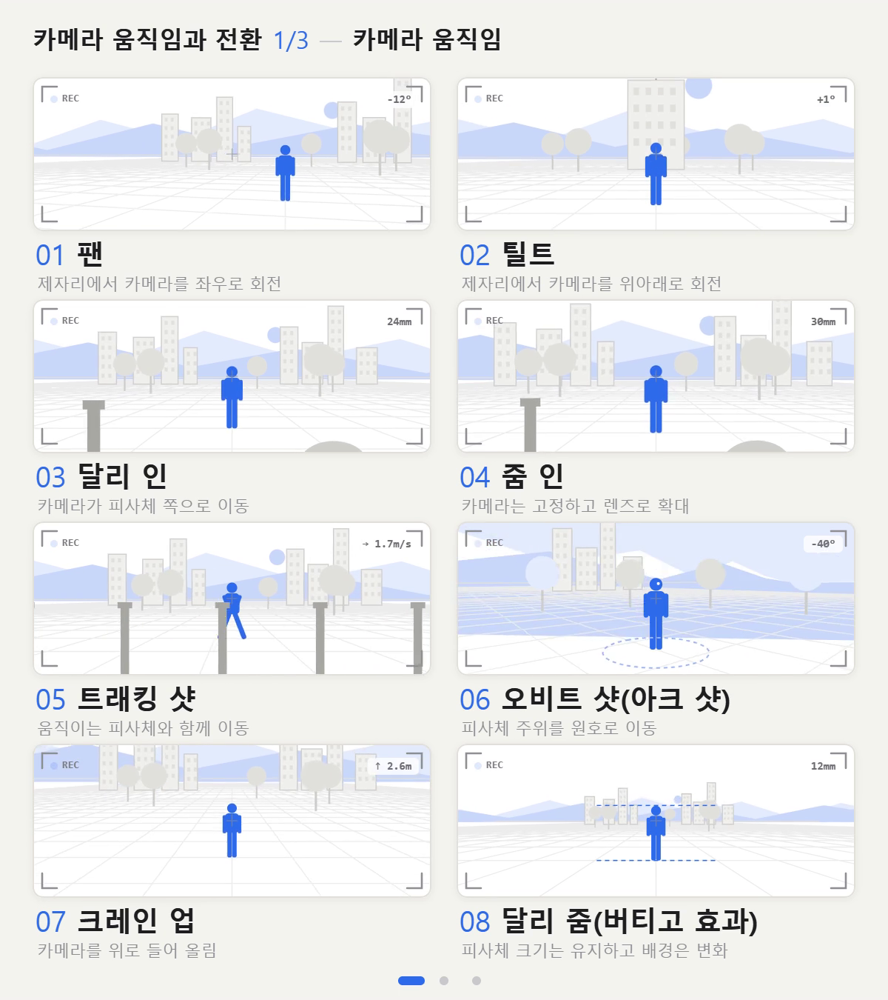
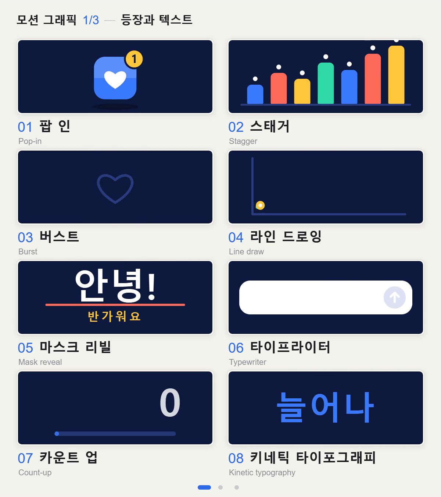

# 나만의 버전 만들기

[English](README.md) | [日本語](README.ja.md) | **한국어**

자신만의 용어 예제 모음을 만드는 프롬프트, 렌더링 스크립트, 완성된 예제 두 세트입니다. 한 세트는 카드 8개씩 들어 있는 반복 영상 3편으로 구성됩니다. 각 카드는 용어 하나의 뜻을 짧은 애니메이션으로 보여 줍니다. 별도의 이미지 생성 프롬프트로 한 장짜리 용어 요약 이미지도 만들 수 있습니다.

자신의 분야, 언어, 시각적 스타일로 만들어 보세요.

| | 카메라 움직임(`examples/camera-moves/`) | 모션 그래픽(`examples/motion-graphics/`) |
|---|---|---|
| 스타일 | 밝은 회색 바탕, 파란색 하나, 픽토그램 | 짙은 네이비 카드, 네 가지 색 |
| 제공 언어 | 영어, 일본어, 한국어 | 일본어, 한국어 |
| |  |  |

기존 영어·일본어 영상과 요약 이미지는 실제 게시된 파일이므로 당시의 표현을 유지합니다. 예를 들어 일본어 원본의 10번은 `手持ち風`이며, 현재 [`packs/`](../packs/README.md) 목록에서는 `手持ち`로 표기합니다.

두 예제는 의도적으로 스타일이 다릅니다. 하나의 스타일을 배포하기 위한 템플릿이 아닙니다. 공통 원칙은 용어가 주인공이며, 각 카드는 그 용어의 뜻을 보여 준다는 것입니다.

## 한국어 예제 영상

[`01-translate.md`](prompts/en/01-translate.md)의 절차에 따라 카메라 움직임 24개와 모션 그래픽 24개를 한국어로 제작했습니다. 아래 각 영상은 9.4초이며, 제목·이름·설명·카드 안의 예시 문구를 현지화했습니다. 한국어 명칭의 실제 사용 근거가 충분하지 않은 용어는 영어 이름과 한국어 설명으로 표시합니다.

| 예제 | 영상 1 · 01–08 | 영상 2 · 09–16 | 영상 3 · 17–24 |
|---|---|---|---|
| 카메라 움직임 | [카메라 움직임](examples/camera-moves/ko/video-1of3.mp4) | [촬영 방식과 시간](examples/camera-moves/ko/video-2of3.mp4) | [장면 전환](examples/camera-moves/ko/video-3of3.mp4) |
| 모션 그래픽 | [등장과 텍스트](examples/motion-graphics/ko/video-1of3.mp4) | [움직임 다듬기](examples/motion-graphics/ko/video-2of3.mp4) | [전환과 강조](examples/motion-graphics/ko/video-3of3.mp4) |

| 확인용 자료 | 1편 | 2편 | 3편 |
|---|---|---|---|
| 카메라 움직임 프레임 모음 | [PNG](examples/camera-moves/ko/video-1of3-sheet.png) | [PNG](examples/camera-moves/ko/video-2of3-sheet.png) | [PNG](examples/camera-moves/ko/video-3of3-sheet.png) |
| 모션 그래픽 프레임 모음 | [PNG](examples/motion-graphics/ko/video-1of3-sheet.png) | [PNG](examples/motion-graphics/ko/video-2of3-sheet.png) | [PNG](examples/motion-graphics/ko/video-3of3-sheet.png) |

수정 가능한 HTML: [카메라 움직임](examples/camera-moves/ko/index.html), [모션 그래픽](examples/motion-graphics/ko/index.html). GitHub에서는 소스가 표시되므로, 내려받아 브라우저로 열면 재생됩니다.

## 구성

```
prompts/en, prompts/ja      코딩 AI·이미지 생성 AI에 복사해 전달할 프롬프트
render.mjs                  HTML -> mp4 (Playwright + ffmpeg)
examples/camera-moves/
  en/  index.html  video-1of3.mp4  video-2of3.mp4  video-3of3.mp4  cheatsheet.png
  ja/  index.html  video-1of3.mp4  video-2of3.mp4  video-3of3.mp4  cheatsheet.png
  ko/  index.html  video-{1,2,3}of3.mp4  video-{1,2,3}of3-sheet.png  preview.png
examples/motion-graphics/
  ja/  index.html  video-1of3.mp4  video-2of3.mp4  video-3of3.mp4  cheatsheet.png  cheatsheet-prompt.md
  ko/  index.html  video-{1,2,3}of3.mp4  video-{1,2,3}of3-sheet.png  preview.png
```

| | |
|---|---|
| 영상 | 1200×1350, 30fps, H.264, yuv420p, 무음, 9.4초, 반복 재생용 |
| 검수용 프레임 모음 | `--sheet`로 영상에서 초당 한 프레임씩 추출한 PNG |
| 용어 요약 이미지 | `prompts/`의 이미지 생성용 프롬프트로 별도 제작 |

한국어 폴더의 `*-sheet.png`는 영상의 시간별 장면을 확인하는 자료입니다. 24개 용어를 한 장에 배치하는 `cheatsheet.png`와 용도가 다릅니다. 한국어 결과물에는 영상과 검수용 프레임 모음을 포함했습니다.

각 예제의 HTML 파일 하나가 `<canvas>`에 그림을 그립니다. 별도의 빌드 과정이나 프레임워크가 없어 코딩 AI가 전체 내용을 읽고 수정할 수 있습니다.

## 프롬프트

코딩 AI에 이 저장소를 제공한 뒤 목적에 맞는 프롬프트를 전달하세요. 번역 프롬프트에서 `<LANGUAGE>`는 `Korean`, `<lang>`은 `ko`로 바꾸면 됩니다.

| 목적 | 프롬프트 |
|---|---|
| 같은 영상을 다른 언어로 만들기 | [`prompts/en/01-translate.md`](prompts/en/01-translate.md) |
| 자신의 분야를 원하는 스타일로 만들기 | [`prompts/en/02-your-own-field.md`](prompts/en/02-your-own-field.md) |
| 한 장짜리 용어 요약 이미지 만들기 | [`prompts/en/03-cheatsheet-image.md`](prompts/en/03-cheatsheet-image.md) |

일본어 프롬프트는 [`prompts/ja/`](prompts/ja/)에 있습니다.

HTML을 직접 수정한다면 다음 부분을 확인하세요.

- `PAGES`, `ITEMS`: 페이지 제목과 24개 용어·설명
- `drawPage()`의 제목, 모션 예제의 `SERIES`: 상단 제목
- `CELLS[0]`부터 `CELLS[23]`: 카드마다 하나씩 있는 그리기 함수
- `C`: 색상. `JP`, `EN`, `MONO` / `DISP`: 글꼴

번역할 때는 화면에 표시되는 문구와 필요한 글꼴만 바꾸세요. 배치·색상·타이밍·그리기 로직과 `REC`, `24mm`, `1.7m/s` 같은 계기 표시는 유지합니다. 제목은 카드 너비 539px 안에서 한 줄로 들어가야 합니다.

## 미리보기

`examples/camera-moves/ko/index.html` 또는 `examples/motion-graphics/ko/index.html`을 Chrome 등 Chromium 기반 브라우저로 열면 반복 재생됩니다.

- `?page=2`는 두 번째 페이지를 표시합니다. 페이지는 1–3입니다.
- `?t=3.5`는 3.5초 지점의 정지 화면을 표시합니다.

## MP4로 렌더링하기

[Node.js](https://nodejs.org/)와 PATH에 등록된 [ffmpeg](https://ffmpeg.org/)가 필요합니다. 원본 안내와 `package.json`은 Node.js 18 이상으로 되어 있지만, 현재 `package-lock.json`에 고정된 Playwright 1.64.0은 Node.js 20 이상을 요구합니다. 아래 명령에는 Node.js 20 이상을 사용하세요.

저장소 루트에서 실행합니다.

```bash
cd make-your-own
npm ci
npx playwright install chromium

# 카메라 움직임: 3편과 각 영상의 프레임 모음
node render.mjs examples/camera-moves/ko/index.html --all --sheet --out-dir out/camera-ko

# 모션 그래픽: 3편과 각 영상의 프레임 모음
node render.mjs examples/motion-graphics/ko/index.html --all --sheet --out-dir out/motion-ko

# 한 페이지만 원하는 파일명으로 저장
node render.mjs examples/camera-moves/ko/index.html --page 1 --out out/camera-ko/video-1of3.mp4
```

`--all` 출력은 각각의 폴더에 `ko-page1.mp4`, `ko-page2.mp4`, `ko-page3.mp4`로 저장됩니다. `--sheet`를 붙이면 같은 이름에 `-sheet.png`가 붙은 프레임 모음도 생성됩니다. 두 예제의 출력 폴더를 구분하면 파일명이 겹치지 않습니다.

사용 가능한 옵션은 `--page <n>`, `--all`, `--pages <n>`, `--out <file>`, `--out-dir <dir>`, `--fps <n>`, `--crf <n>`, `--sheet`입니다. 자세한 설명은 `node render.mjs --help`로 확인하세요. 이 예제의 `--fps`는 HTML의 `FPS`와 같은 30을 유지합니다.

렌더링 후 세 장의 프레임 모음을 열어 각 카드의 글자 잘림, 겹침, 빈 사각형으로 표시되는 글꼴 누락을 확인하세요. 텍스트가 움직이는 카드는 여러 시점에서 살펴봅니다.

### 렌더링 원리

HTML은 실제 시계를 사용하지 않습니다. 각 프레임은 프레임 번호로 그려집니다.

| HTML 항목 | 의미 |
|---|---|
| `window.N_FRAMES` | 한 페이지의 프레임 수. 282 = 9.4초 × 30fps |
| `window.renderFrame(i)` | `<canvas id="c">`에 i번째 프레임 그리기 |
| `window.prepareFrame(i)` | 선택 사항. 비동기 처리도 가능 |
| `window.READY` | 글꼴 준비가 끝나면 `true` |
| `?page=N`, `?render=1` | 렌더링할 페이지 지정, 미리보기 반복 재생 끄기 |

`render.mjs`는 각 프레임의 `renderFrame(i)`를 호출하고 Canvas를 PNG로 읽어 ffmpeg에 전달합니다. 따라서 느린 컴퓨터에서도 프레임이 빠지지 않습니다. 위 규약을 따르는 HTML은 같은 스크립트로 렌더링할 수 있습니다.

## 글꼴

예제는 웹 글꼴, CDN, 외부 이미지를 불러오지 않습니다. 기존 영어·일본어 예제는 macOS에 포함된 Helvetica Neue, Avenir Next, Hiragino Sans, SF Mono를 사용하며, 글꼴 파일은 저장소에 포함하지 않습니다.

기존 영어·일본어 MP4는 macOS에서 렌더링했습니다. Windows나 Linux에서 HTML을 열면 다른 글꼴로 대체되어 모양이 조금 달라지며, 일본어 버전에는 Noto Sans JP 같은 일본어 글꼴이 필요합니다. 글꼴을 바꾸려면 `index.html` 상단의 글꼴 상수를 수정하세요.

한국어 MP4는 Windows에서 맑은 고딕(Malgun Gothic)으로 렌더링했습니다. 카메라 계기 표시는 Consolas, 모션 그래픽의 영어 보조 표기는 Arial을 사용합니다. 해당 글꼴이 없는 환경에서는 Noto Sans KR 등 한글 글꼴을 설치하고 글꼴 상수를 바꾼 뒤 다시 검수하세요. 프레임 모음(`*-sheet.png`)은 영상 검수용이며, 기존 예제의 이미지 생성 AI로 만든 `cheatsheet.png`와 용도가 다릅니다.

## 참고 사항

- 일본어 HTML은 처음에 세 페이지를 순서대로 보여 주는 30초짜리 영상으로 작성되었습니다. 현재 예제는 영어판처럼 페이지별로 렌더링합니다. 원본 게시물의 일본어 MP4와 새 렌더링은 하드 컷에서 한 프레임 정도 차이가 날 수 있습니다.
- 예제 HTML의 코드 주석은 대부분 일본어입니다.
- Canvas의 `roundRect`, `letterSpacing`을 사용하므로 최근 Chromium이 필요합니다. 일반 설치 절차에서는 Playwright가 설치한 Chromium을 사용합니다.
- 두 예제의 카드는 갤러리의 `camera`, `motion` 팩에도 들어 있습니다. [팩 목록](../packs/README.md)을 참고하세요. 새 세트를 갤러리에 추가하는 절차는 원본 기여 안내의 [영문](../CONTRIBUTING.md)과 [일문](../CONTRIBUTING.ja.md)에 있습니다.

## 라이선스

[MIT](../LICENSE). 이곳의 코드, 영상, 이미지는 상업 작업을 포함해 자신의 작업에 사용할 수 있습니다. 원본으로 연결되는 링크를 남겨 주시면 좋지만 필수는 아닙니다.
