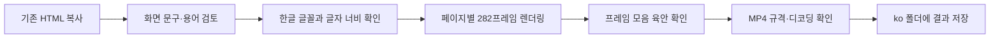

# 한국어 예제 제작 기록

[한국어 제작 안내](README.ko.md) · [전체 팩 번역 안내](../packs/TRANSLATION.ko.md)

제작·확인일: 2026-10-30. 기준 소스는 이 저장소의 커밋 `7819d3879eb7d5a1475c11c001bedffb5cab64af`에 있는 [카메라 영어 예제](examples/camera-moves/en/index.html)와 [모션 그래픽 일본어 예제](examples/motion-graphics/ja/index.html)입니다. [`01-translate.md`](prompts/en/01-translate.md)에 따라 한국어 HTML 2개, MP4 6편, 검수용 프레임 모음 6장을 만들었습니다.

## 적용과 검수

| 검수 항목 | 결과 |
|---|---|
| 번역 범위 | 제목, 페이지명, 용어, 설명, 카드 속 예시 문구. 모션 예제는 한국어 이름 아래 영어 원어 병기 |
| 원본 유지 | 번역 문자열·글꼴 설정·문서 언어와 제목을 제외한 소스를 비교하여 동일함을 확인. 배치·색상·타이밍·그리기 로직 유지 |
| 계기 표시 | `REC`, `24mm`, `1.7m/s`, `HANDHELD`, `FREEZE` 등 원문 유지 |
| 문자 형태를 사용하는 효과 | 모션 20번의 `ZOOM`·`GO!`는 O의 구멍을 통과하는 그림의 일부이므로 유지. 질문·답변 기호인 `Q`·`A`도 유지 |
| 입력·글자별 애니메이션 | 타이프라이터 예문은 원문과 같은 9문자, 글자별 운동 예문은 각 3문자로 맞춰 타이밍 유지 |
| 글꼴 | Windows 설치 글꼴 맑은 고딕. 카메라 계기 표시는 Consolas, 모션의 영어 보조 문구는 Arial |
| 카드 제목 너비 | 번호와 간격 포함 최댓값: 카메라 408.4px, 모션 408.9px. 모두 카드 너비 539px 이내 |
| 글자 크기 | 원본 유지. 이름은 카메라 37px, 모션 36px, 보조 문구는 22px |
| 페이지 제목 | 6개 페이지 모두 오른쪽 여백 안에 들어옴 |
| 브라우저 실행 | 한글 글꼴 로딩 확인, 6개 페이지에서 JavaScript 오류 없음 |
| 육안 검수 | 최종 영상에서 추출한 프레임 모음 6장 확인. 제목·설명 겹침, 잘림, 한글 누락 없음. 마스크·확대·글리치 효과에 의한 의도적인 가림은 유지 |
| 영상 규격 | 6편 모두 1200×1350, 30fps, 282프레임, 9.4초, H.264, yuv420p, 오디오 스트림 없음 |
| 파일 검사 | `ffprobe -count_frames`로 규격과 프레임 수 확인, `ffmpeg -xerror`로 전체 디코딩 오류 없음 확인 |

검수용 프레임 모음과 영상은 [제작 안내의 결과물 표](README.ko.md#한국어-예제-영상)에 연결되어 있습니다. 각 `preview.png`는 해당 예제의 첫 번째 MP4에서 추출했습니다.

## 실제 제작 환경

| 항목 | 사용한 환경 |
|---|---|
| 운영체제 | Windows |
| Node.js | 24.19.0 |
| Playwright | 실행 환경에 설치된 1.62.1 |
| 브라우저 | 설치된 Google Chrome 156.0.8078.49, headless |
| ffmpeg·ffprobe | 8.1.1 |
| 한글 글꼴 파일 | `C:\Windows\Fonts\malgun.ttf`, `malgunbd.ttf` |
| 렌더링 코드 | 저장소의 `render.mjs`, 수정 없음 |
| 인코딩 | 원본 기본값: libx264, preset slow, CRF 18, yuv420p, faststart |

이 환경에서는 npm 실행 도구의 버전 선택 오류로 `npm ci`가 완료되지 않아, 이미 설치된 Playwright와 Chrome을 연결하는 임시 실행 설정을 사용했습니다. 저장소의 `package.json`, 잠금 파일, 렌더링 코드는 변경하지 않았습니다. 따라서 위 버전은 이번 결과물을 만든 실제 환경이며, 잠금 파일의 Playwright 1.64.0으로 생성한 결과라고 주장하지 않습니다. 일반적인 재생성 명령과 Node.js 요구 버전은 [제작 안내](README.ko.md#mp4로-렌더링하기)에 있습니다.

글꼴 파일은 배포하지 않습니다. 다른 환경에서 HTML을 재생성하면 설치된 글꼴과 브라우저에 따라 글자 너비·안티앨리어싱이 달라질 수 있으므로 다시 검수해야 합니다.

## 카메라 움직임: 24개 이름

아래 번호는 영상 안의 01–24입니다. 팩의 공개 번호로는 #025–048에 해당합니다. [원본 목록](../packs/camera/meta.json)의 영어 이름·뜻과 화면 동작을 대조했습니다. 외부 출처의 한국어 표기를 직접 확인한 경우와, 개념을 확인하고 음역을 선택한 경우를 구분합니다. 모든 한국어 이름이 하나의 업계 표준이라는 뜻은 아닙니다.

| 영상 번호 | 영어 원어 | 영상의 한국어 이름 | 확인 범위·선택 메모 |
|---|---|---|---|
| 01 | Pan | 팬 | [Adobe Pan shot][pan]에서 수평 회전 개념 확인. 음역 사용 |
| 02 | Tilt | 틸트 | [Adobe Pan shot][pan]에서 수직 회전과 구분. 음역 사용 |
| 03 | Dolly in | 달리 인 | [Adobe Pan shot][pan]에서 카메라 이동 개념 확인. 달리·돌리 표기 차이 있음 |
| 04 | Zoom in | 줌 인 | 원본 대조. 카메라 이동 없이 렌즈로 확대하는 점을 설명 |
| 05 | Tracking shot | 트래킹 샷 | [Adobe 카메라 샷 안내][camera]에서 표기·개념 확인 |
| 06 | Orbit (Arc shot) | 오비트 샷(아크 샷) | 원본의 두 이름을 병기. 두 한국어 표기의 통용 범위는 추가 확인 필요 |
| 07 | Crane up | 크레인 업 | 원본 대조·음역. 크레인 샷과 상승 방향을 함께 표시하며 정확한 한국어 명칭은 추가 확인 필요 |
| 08 | Dolly zoom (Vertigo) | 달리 줌(버티고 효과) | 원본 대조·음역. 달리·돌리, 버티고·현기증 효과 등 표기 차이 있음 |
| 09 | Rack focus | 랙 포커스 | [Adobe 보케 영상 안내][focus]에서 한국어 표기 확인 |
| 10 | Handheld | 핸드헬드 | 원본 대조·음역. 손으로 들고 촬영하는 흔들림으로 설명 |
| 11 | FPV drone shot | FPV 드론 샷 | [DJI Avata 2 소개][fpv]의 FPV 비행 개념 확인. 전체 이름은 원문 음역 |
| 12 | Dutch angle | 더치 앵글 | [Adobe 카메라 샷 안내][camera]에서 표기·개념 확인 |
| 13 | Slow motion | 슬로 모션 | [Adobe 속도 조정 안내][speed]의 '슬로우 모션'과 같은 개념. 짧은 음역 사용 |
| 14 | Speed ramp | 스피드 램프 | [Adobe 속도 조정 소개][ramp]의 '스피드 램프' 표기 확인 |
| 15 | Time-lapse | 타임랩스 | [Adobe 타임랩스 안내][timelapse]에서 한국어 표기 확인 |
| 16 | Freeze frame | 프리즈 프레임 | 원본 대조·음역. 동작을 정지 화면으로 유지하는 뜻을 설명 |
| 17 | Jump cut | 점프 컷 | [Adobe 전환 효과 안내][transitions]에서 표기·개념 확인 |
| 18 | Match cut | 매치 컷 | [Adobe 전환 효과 안내][transitions]에서 표기·개념 확인 |
| 19 | Whip pan | 휩 팬 | [Adobe Pan shot][pan]에서 빠른 팬 개념 확인. 휩·휘프 표기 차이 있음 |
| 20 | Cross dissolve | 크로스 디졸브 | [Adobe 전환 효과 안내][transitions]의 '교차 디졸브'와 같은 개념. 원어 음역 선택 |
| 21 | Wipe | 와이프 | [Adobe 전환 효과 안내][transitions]에서 표기·개념 확인 |
| 22 | Smash cut | 스매시 컷 | 원본 대조·음역. 이번에 확인한 공식 한국어 자료에는 직접 표기가 없어 추가 확인 필요 |
| 23 | J-cut | J컷 | [Adobe 전환 효과 안내][transitions]에서 소리 선행과 표기 확인 |
| 24 | L-cut | L컷 | [Adobe 전환 효과 안내][transitions]에서 소리 후행과 표기 확인 |

## 모션 그래픽: 24개 이름

이 번호는 팩의 #001–024와 같습니다. [원본 목록](../packs/motion/meta.json)과 일본어 예제의 영문 보조 표기를 기준으로 검토했습니다. 효과 이름은 제품별 메뉴명과 다를 수 있어 영어 원어를 함께 표시합니다.

| 영상 번호 | 영어 원어 | 영상의 이름 | 확인 범위·선택 메모 |
|---|---|---|---|
| 01 | Pop-in | 팝 인 | 원본 대조·음역. 크기가 튀어나오듯 커지는 등장 |
| 02 | Stagger | 스태거 | [GSAP Staggers][stagger]에서 시간차 적용 개념 확인. 한국어 표기는 음역 |
| 03 | Burst | 버스트 | 원본 대조·음역. 중심에서 퍼지는 효과 |
| 04 | Line draw | 라인 드로잉 | 원본 대조. 선이 그려지는 효과를 나타내는 음역이며 단일 표준명은 미확인 |
| 05 | Mask reveal | 마스크 리빌 | [Adobe 마스크 안내][mask]로 가림·표시 개념 확인. 전체 이름의 한국어 표준 표기는 미확인 |
| 06 | Typewriter | 타이프라이터 | 원본 대조·음역. 글자를 차례로 입력하는 효과 |
| 07 | Count-up | 카운트 업 | 원본 대조·음역. 숫자가 목표값까지 증가 |
| 08 | Kinetic typography | 키네틱 타이포그래피 | [Adobe 텍스트 애니메이션 소개][kinetic]에서 한국어 표기 확인 |
| 09 | Easing | 이징 | [GSAP Eases][easing]에서 시간에 따른 변화율 개념 확인. 한국어 표기는 음역 |
| 10 | Overshoot | 오버슈트 | 원본 대조·음역. 목표를 지나쳤다가 되돌아옴 |
| 11 | Squash & stretch | 스쿼시 앤 스트레치 | [Adobe 애니메이션 소개][squash]에서 한국어 표기 확인 |
| 12 | Shape morph | 셰이프 모핑 | 원본 대조·음역. 도형 간 형태 변환이며 단일 한국어 표준명은 미확인 |
| 13 | Liquid motion | 리퀴드 모션 | 원본 대조·음역. 액체처럼 변형되는 움직임이며 단일 한국어 표준명은 미확인 |
| 14 | Motion trail | 모션 트레일 | 원본 대조·음역. 움직이는 물체 뒤의 잔상·궤적 |
| 15 | Particles | 파티클 | [Adobe 효과 목록][effects]의 입자 효과와 대조. 영상에는 원어 음역 사용 |
| 16 | Parallax | 패럴랙스 | 원본 대조·음역. 앞뒤 레이어가 서로 다른 속도로 이동 |
| 17 | Mask transition | 마스크 전환 | [Adobe 마스크 안내][mask]의 개념과 원본 대조. 특정 제품 메뉴명은 아님 |
| 18 | Shape transition | 도형 전환 | 원본의 기능을 설명하는 이름. 단일 한국어 표준명 미확인, 영어 병기 |
| 19 | Liquid transition | 리퀴드 전환 | 원본의 기능을 설명하는 이름. 단일 한국어 표준명 미확인, 영어 병기 |
| 20 | Zoom through | Zoom through | 확실한 한국어 명칭을 확인하지 못해 영어 유지. 아래에 '글자 속을 통과하는 확대 전환' 표시 |
| 21 | Flip | 플립 | 원본 대조·음역. 카드를 뒤집는 회전 |
| 22 | Light sweep | 라이트 스윕 | [Adobe 효과 목록][effects]의 `CC Light Sweep` 명칭과 개념 대조. 한국어 표기는 음역 |
| 23 | Glitch | 글리치 | 원본 대조·음역. 영상 신호가 깨지는 듯한 효과 |
| 24 | Impact shake | Impact shake | 확실한 한국어 명칭을 확인하지 못해 영어 유지. 아래에 '충격에 맞춰 화면이 흔들림' 표시 |

## 표기상 한계와 후속 수정 기준

카메라 06·07·08·19·22번은 음역·별칭 차이에 주의가 필요합니다. 모션 04·05·12·13·17·18·19번도 제품이나 작업자에 따라 표현이 달라질 수 있습니다. 위 표의 '원본 대조·음역' 항목은 영어 의미와 그림을 맞췄다는 뜻이며, 공식 한국어 명칭을 외부 출처에서 확인했다는 뜻은 아닙니다.

`Impact shake`는 팩 문서에 있는 '충격 흔들림'을 정식 전문 용어로 보기 어려워 영상 제목에서는 영어로 유지했습니다. `Zoom through`도 영어 이름과 한국어 설명을 사용합니다. 새로운 통용 표기를 확인하면 출처를 남기고 HTML의 `ITEMS`를 수정한 뒤 제목 너비와 영상을 다시 검수하세요.

아래 자료는 해당 행에 적은 개념·표기의 근거입니다. 영어 문서는 한국어 음역의 통용성을 보증하지 않습니다.

[pan]: https://www.adobe.com/creativecloud/video/production/cinematography/camera-shots-and-angles/pan-shot.html
[camera]: https://www.adobe.com/kr/creativecloud/video/production/cinematography/camera-shots-and-angles.html
[focus]: https://www.adobe.com/kr/creativecloud/video/discover/create-bokeh-effect-in-video.html
[fpv]: https://www.dji.com/kr/newsroom/news/dji-launch-avata-2-kr
[speed]: https://www.adobe.com/kr/creativecloud/roc/blog/video/instagram-reels-edit.html
[ramp]: https://blog.adobe.com/ko/publish/2019/08/07/rush-speed-kr
[timelapse]: https://www.adobe.com/kr/creativecloud/video/discover/time-lapse-video.html
[transitions]: https://www.adobe.com/kr/creativecloud/video/discover/types-of-film-transitions.html
[stagger]: https://gsap.com/resources/getting-started/Staggers/
[easing]: https://gsap.com/docs/v3/Eases/
[mask]: https://helpx.adobe.com/kr/after-effects/desktop/drawing-painting-and-paths/work-with-masks/create-masks.html
[kinetic]: https://www.adobe.com/kr/products/aftereffects/text-animation.html
[squash]: https://www.adobe.com/kr/products/firefly/features/ai-animation-generator/cartoon-video.html
[effects]: https://helpx.adobe.com/kr/after-effects/desktop/apply-effects-and-animation-presets/effects-and-animation-presets/effect-list.html
