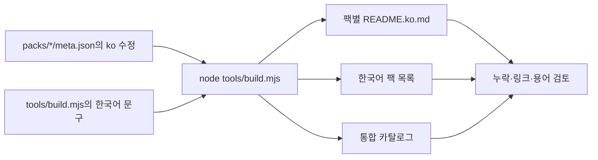

# 한국어 번역 안내

[한국어 팩 목록](README.ko.md) · [프로젝트 소개](../README.ko.md)

한국어 언어 코드는 `ko`이므로 파일명은 `README.ko.md`를 사용합니다. `KR`은 대한민국의 국가 코드입니다.

## 번역 범위

| 대상 | 한국어 지원 |
|---|---|
| 프로젝트 소개 | 루트의 `README.ko.md` |
| 팩 목록 | `packs/README.ko.md` |
| 8개 팩, 192개 용어 | 각 팩의 `README.ko.md`: 이름, 영어 원어, 뜻, AI 요청 예시 |
| 원본 데이터 | 각 `meta.json`의 `title`, `categories`, `name`, `meaning`, `ask`에 `ko` 추가 |
| 통합 카탈로그 | `api/v1/catalog.json`, `assets/catalog.js`에 한국어 데이터 포함 |
| 상세 사양과 사용처 | `summary`, `spec`, `use`는 기존 영어·일본어 유지 |
| 갤러리 UI와 스킬 CLI | 기존 영어·일본어 유지 |
| 예제 영상·HTML·글꼴 | 카메라 움직임·모션 그래픽 한국어 HTML, 영상 6편, 프레임 모음 6장. 맑은 고딕 사용 |

[`01-translate.md`](../make-your-own/prompts/en/01-translate.md)의 용어 선택 원칙을 참고하고, 문서 번역에는 [CONTRIBUTING.md의 언어 추가 절차](../CONTRIBUTING.md#add-a-language-to-an-existing-pack)를 적용했습니다. 영상용 화면 문구·글꼴·렌더링과 검수 결과는 [한국어 예제 제작 기록](../make-your-own/TRANSLATION.ko.md)에 있습니다. 영상과 제작 방법은 [한국어 제작 안내](../make-your-own/README.ko.md)에서 확인하세요.

## 번역 수정과 생성



생성된 팩별 README를 직접 수정하면 다음 빌드에서 덮어씁니다. 이름·뜻·요청 예시는 각 팩의 `meta.json`에서 수정하세요. 표 머리글과 공통 안내는 `tools/build.mjs`의 `DOC.ko`, 팩 목록의 안내는 `packsIndex()`에서 수정합니다. 루트의 `README.ko.md`와 이 안내 문서는 직접 관리합니다.

```sh
node tools/build.mjs
node tools/build.mjs --check
git diff --check
```

공개된 번호, 영어 이름, 슬러그, 태그, 애니메이션 코드는 번역으로 바꾸지 않습니다. 요청 예시의 시간·각도·거리·비율도 원문 값을 유지합니다. 한국어에서는 '도도부현' 선택 예시를 '시·도'로 표현하는 등 사용 맥락에 맞춰 문구를 조정했습니다.

## 용어 확인 자료

뜻과 요청 예시의 기준은 각 팩의 영어 `meta.json`입니다. 아래는 외부 공식 문서로 추가 대조한 용어와 개념입니다. 외부 문서가 영어인 경우 개념을 확인하는 자료이며, 한국어 표기 전체를 보증하는 출처는 아닙니다. 확인일: 2026-10-30.

| 용어·개념 | 참고 자료 | 적용 |
|---|---|---|
| 스태거 | [GSAP Staggers](https://gsap.com/resources/getting-started/Staggers/) | #002의 시간차 등장 |
| 마스크 | [Adobe After Effects: 마스크 만들기](https://helpx.adobe.com/kr/after-effects/desktop/drawing-painting-and-paths/work-with-masks/create-masks.html) | #005, #017, #133의 가림·표시 개념 |
| 위글·리피터 | [Adobe After Effects: 모양 특성과 패스 작업](https://helpx.adobe.com/kr/after-effects/desktop/drawing-painting-and-paths/shapes-and-shape-attributes/shape-attributes-paint-operations-path.html) | #124, #134의 흔들기·반복 개념 |
| 텍스트 스크램블 | [GSAP ScrambleText](https://gsap.com/docs/v3/Plugins/ScrambleTextPlugin/) | #129의 무작위 문자 전환 |
| 팬·틸트·달리 | [Adobe: Pan shot](https://www.adobe.com/creativecloud/video/production/cinematography/camera-shots-and-angles/pan-shot.html) | #025–027에서 카메라 회전과 이동 구분 |
| 트래킹 샷·더치 앵글·클로즈업·시점 샷·하이/로우 앵글 | [Adobe: 영화 속 다양한 샷과 카메라 앵글](https://www.adobe.com/kr/creativecloud/video/production/cinematography/camera-shots-and-angles.html) | #029, #036, #177–181, #184 |
| J컷·L컷 | [Adobe Premiere: J컷과 L컷 만들기](https://helpx.adobe.com/kr/premiere/desktop/edit-projects/trim-clips/perform-j-cuts-and-l-cuts.html) | #047–048의 소리 선행·후행 구분 |
| 설정 샷 | [Adobe: 영화 설정 샷](https://www.adobe.com/kr/creativecloud/video/discover/establishing-shot.html) | #183의 장소 소개 |
| 모달·아코디언·브레드크럼·캐러셀·탭·슬라이더 | [W3C WAI-ARIA 패턴](https://www.w3.org/WAI/ARIA/apg/patterns/) | UI 패턴의 영어 원어와 기능 구분 |
| 바텀 시트·배지·캐러셀·칩 | [Android Developers: Material 구성요소](https://developer.android.com/develop/ui/compose/components?hl=ko) | #051, #058, #061, #071 |
| 오프캔버스·페이지네이션·팝오버·스피너·토스트·스크롤스파이 | [Bootstrap 구성요소 및 Scrollspy](https://getbootstrap.com/docs/5.3/components/scrollspy/) | UI 용어 및 #150의 현재 섹션 강조 |
| 피닝·스크롤 연동 | [GSAP ScrollTrigger](https://gsap.com/docs/v3/Plugins/ScrollTrigger/) | #076과 스크롤에 따른 효과 진행 |
| 스크롤 스냅 | [MDN: CSS Scroll Snap](https://developer.mozilla.org/ko/docs/Web/CSS/CSS_scroll_snap) | #078의 스크롤 정렬 |
| 인물 조명·렘브란트 조명 | [Adobe: 인물 사진 조명](https://www.adobe.com/kr/creativecloud/photography/discover/portrait-lighting.html) | 조명의 방향과 #101의 표기 |
| 보케 | [Adobe Lightroom: 렌즈 흐림 효과](https://helpx.adobe.com/kr/lightroom/web/edit-photos/apply-effects/apply-lens-blur.html) | #105의 초점 밖 빛 표현 |
| 렌즈 플레어 | [Adobe: 렌즈 플레어 사진](https://www.adobe.com/kr/creativecloud/photography/discover/lens-flare.html) | #109의 표기와 광학 효과 |

## 표기 선택과 검토가 필요한 이름

용어 목록의 영어 원어 열을 함께 사용하면 소프트웨어마다 다른 번역과 표기 차이를 확인할 수 있습니다. 아래 항목은 한국어 명칭이 하나로 통일되었다고 보기 어려워 선택 근거를 남깁니다.

| 번호 | 원어 | 선택과 확인 한계 |
|---|---|---|
| #020 | Zoom through | 통용되는 단일 한국어 명칭을 확인하지 못해 영어를 유지하고 뜻을 한국어로 설명했습니다. |
| #024 | Impact shake | 팩 문서의 '충격 흔들림'은 뜻을 풀이한 이름이며 통용되는 전문 용어로 확인되지 않았습니다. 한국어 예제 영상에서는 영어 이름을 유지하고 한국어 설명을 붙였습니다. |
| #027, #032 | Dolly in / Dolly zoom | '달리'로 통일했습니다. '돌리' 표기도 쓰이므로 검색할 때 영어 원어를 함께 사용하세요. |
| #030 | Orbit (Arc shot) | '오비트 샷(아크 샷)'으로 두 명칭을 함께 표시했습니다. |
| #043 | Whip pan | '휩 팬'을 사용했습니다. 소프트웨어 번역에서는 '휘프 팬'으로도 표시됩니다. |
| #060 | Segmented control | '세그먼트 컨트롤'을 사용했습니다. 플랫폼에 따라 '분할 버튼' 등 다른 이름을 사용합니다. |
| #081, #084, #154, #156, #157, #165 | Hover lift, Magnetic button, Spotlight hover, Text roll on hover, Hover image reveal, Animated shape divider | 원문이 효과를 묘사하는 이름입니다. 한국어 단일 표준 명칭은 확인하지 못했으며, 이해를 돕는 설명형 이름과 영어 원어를 함께 제공합니다. |
| #121–122 | Anticipation / Follow-through | 음역과 '예비 동작 / 후속 동작' 설명을 병기했습니다. |
| #136 | Line boil | 통용되는 단일 한국어 명칭을 확인하지 못해 영어를 유지했습니다. 손그림 선이 프레임마다 떨리는 효과입니다. |
| #169 | Pedestal | '페데스털'로 표기하고 카메라 전체의 수직 이동으로 설명했습니다. 틸트와 구분합니다. |
| #181 | Bird's-eye view | '버드아이 뷰'로 표기했습니다. 이 예제의 수직 하향 구도를 뜻에 명시했습니다. |

이 목록은 모든 한국어 표현이 업계 표준임을 인증하는 자료가 아닙니다. 더 널리 쓰이는 표현을 확인하면 출처와 함께 해당 `meta.json`의 `ko` 값을 수정하고 빌드하세요.
