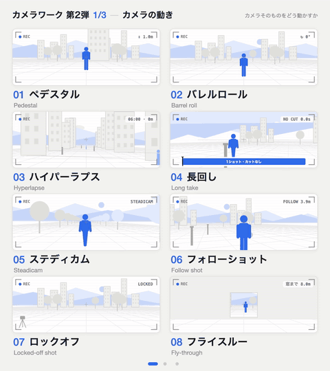

<!-- tools/build.mjs가 meta.json에서 생성한 파일입니다. 수정할 때는 meta.json을 편집하세요. -->

# 카메라 움직임과 장면 전환 2

24개 용어 · #169–192 · 팩 `camera2` · 언어: [English](README.md) / [Español](README.es.md) / [日本語](README.ja.md) / [简体中文](README.zh-Hans.md) / [繁體中文](README.zh-Hant.md)

원하는 이름을 찾은 뒤 AI에게 그대로 전달하세요. 지속 시간, 강도, 움직일 대상을 덧붙이면 원하는 결과에 더 가까워집니다.

## 카메라 움직임

| 번호 | 이름 | 영어 원어 | 뜻 | AI 요청 예시 |
|---|---|---|---|---|
| [#169](https://showheyohtaki.github.io/motion-prompt/?lang=ko#169) | **페데스탈(카메라 수직 이동)** | Pedestal | 카메라 전체를 수직으로 올리거나 내림 | 카메라가 정면을 향한 채 눈높이에서 약 3m 높이까지 페데스탈로 수직 이동해 줘. |
| [#170](https://showheyohtaki.github.io/motion-prompt/?lang=ko#170) | **배럴 롤** | Barrel roll | 카메라를 촬영 축을 중심으로 한 바퀴 회전시킴 | 드론 샷에 배럴 롤을 넣어 줘. 3초 동안 한 바퀴 회전하게 해 줘. |
| [#171](https://showheyohtaki.github.io/motion-prompt/?lang=ko#171) | **하이퍼랩스** | Hyperlapse | 카메라가 이동하며 촬영하는 타임랩스 | 역에서 공원까지 걸어가는 하이퍼랩스를 만들어 줘. 구름이 흐르고 사람들이 빠르게 움직이게 해 줘. |
| [#172](https://showheyohtaki.github.io/motion-prompt/?lang=ko#172) | **롱 테이크** | Long take | 컷 없이 하나의 샷으로 계속 촬영함 | 준비부터 출발까지 인물을 따라가며 컷 없이 하나의 롱 테이크로 촬영해 줘. |
| [#173](https://showheyohtaki.github.io/motion-prompt/?lang=ko#173) | **스테디캠** | Steadicam | 흔들림 없이 떠다니듯 부드럽게 이동함 | 복도를 걷는 인물을 스테디캠으로 따라가 줘. 흔들림 없이 부드럽게 움직여 줘. |
| [#174](https://showheyohtaki.github.io/motion-prompt/?lang=ko#174) | **팔로 샷** | Follow shot | 움직이는 피사체를 뒤에서 따라감 | 숲속을 걷는 인물을 조금 떨어진 뒤에서 팔로 샷으로 따라가 줘. |
| [#175](https://showheyohtaki.github.io/motion-prompt/?lang=ko#175) | **고정 샷** | Locked-off shot | 카메라는 고정하고 피사체만 움직임 | 횡단보도를 고정 샷으로 촬영해 줘. 카메라는 삼각대에 고정하고 사람과 차만 지나가게 해 줘. |
| [#176](https://showheyohtaki.github.io/motion-prompt/?lang=ko#176) | **플라이 스루** | Fly-through | 열린 공간을 날아서 통과해 다음 공간으로 들어감 | 창문을 지나 방 안으로 들어와 탁자까지 이동하는 플라이 스루로 촬영해 줘. |

## 앵글과 구도

| 번호 | 이름 | 영어 원어 | 뜻 | AI 요청 예시 |
|---|---|---|---|---|
| [#177](https://showheyohtaki.github.io/motion-prompt/?lang=ko#177) | **로우 앵글** | Low angle | 낮은 위치에서 위로 올려다보며 촬영함 | 주인공이 등장하는 장면을 지면 가까이에서 올려다보는 로우 앵글로 촬영해 줘. |
| [#178](https://showheyohtaki.github.io/motion-prompt/?lang=ko#178) | **하이 앵글** | High angle | 높은 위치에서 아래를 내려다보며 촬영함 | 길을 잃은 아이 장면은 하이 앵글로 촬영해 줘. 위에서 내려다봐 아이가 작아 보이게 해 줘. |
| [#179](https://showheyohtaki.github.io/motion-prompt/?lang=ko#179) | **시점 샷(POV)** | POV shot | 등장인물의 눈으로 보는 화면 | 문을 열고 방에 들어가는 순간을 인물의 눈으로 보는 시점 샷으로 촬영해 줘. |
| [#180](https://showheyohtaki.github.io/motion-prompt/?lang=ko#180) | **오버 더 숄더 샷** | Over-the-shoulder | 한 사람의 어깨 너머로 다른 사람을 담음 | 대화를 오버 더 숄더 샷으로 촬영해 줘. 앞쪽 어깨는 살짝 흐리게 해 줘. |
| [#181](https://showheyohtaki.github.io/motion-prompt/?lang=ko#181) | **버즈 아이 뷰** | Bird's-eye view | 바로 위에서 수직으로 내려다봄 | 교차로를 바로 위에서 내려다보는 버즈 아이 뷰로 촬영해 줘. 사람과 차가 움직이는 모습을 위에서 보여 줘. |
| [#182](https://showheyohtaki.github.io/motion-prompt/?lang=ko#182) | **딥 포커스** | Deep focus | 가까운 곳부터 먼 곳까지 모두 선명하게 초점을 맞춤 | 딥 포커스로 앞의 컵과 뒤의 인물이 모두 선명하게 나오게 해 줘. |
| [#183](https://showheyohtaki.github.io/motion-prompt/?lang=ko#183) | **설정 샷** | Establishing shot | 장소를 소개하는 넓은 구도의 도입 샷 | 마을 전체를 보여 주는 설정 샷으로 시작하고, 화면에 장소 이름을 표시해 줘. |
| [#184](https://showheyohtaki.github.io/motion-prompt/?lang=ko#184) | **익스트림 클로즈업** | Extreme close-up | 작은 부분 하나로 화면을 가득 채움 | 눈물이 떨어지는 순간 눈만 익스트림 클로즈업해 줘. |

## 전환과 편집

| 번호 | 이름 | 영어 원어 | 뜻 | AI 요청 예시 |
|---|---|---|---|---|
| [#185](https://showheyohtaki.github.io/motion-prompt/?lang=ko#185) | **인서트 샷** | Insert shot | 같은 장면의 세부 모습을 끼워 넣음 | 열쇠를 돌리는 손의 인서트 샷을 넣은 뒤 바로 원래 장면으로 돌아가 줘. |
| [#186](https://showheyohtaki.github.io/motion-prompt/?lang=ko#186) | **모프 컷** | Morph cut | 두 테이크를 자연스럽게 합쳐 연결부를 감춤 | 인터뷰에서 반복한 문장을 모프 컷으로 제거해 줘. 연결부가 드러나지 않게 해 줘. |
| [#187](https://showheyohtaki.github.io/motion-prompt/?lang=ko#187) | **페이드 투 블랙** | Fade to black | 화면이 점점 어두워져 검은색이 됨 | 장면을 1초의 페이드 투 블랙으로 끝낸 뒤, 검은 화면에서 다시 페이드 인해 줘. |
| [#188](https://showheyohtaki.github.io/motion-prompt/?lang=ko#188) | **아이리스 아웃** | Iris out | 원형으로 화면이 좁아지며 검은색으로 닫힘 | 옛 영화처럼 주인공을 중심으로 원이 닫히는 아이리스 아웃으로 장면을 끝내 줘. |
| [#189](https://showheyohtaki.github.io/motion-prompt/?lang=ko#189) | **컷어웨이** | Cutaway | 다른 대상을 잠깐 보여 준 뒤 원래 장면으로 돌아옴 | 발표 중간에 관객 반응으로 컷어웨이했다가 돌아와 줘. |
| [#190](https://showheyohtaki.github.io/motion-prompt/?lang=ko#190) | **교차 편집** | Cross-cutting | 동시에 일어나는 두 장면을 번갈아 보여 줌 | 달리는 사람과 뒤쫓는 자동차를 교차 편집해 줘. 컷 길이가 점점 짧아지게 해 줘. |
| [#191](https://showheyohtaki.github.io/motion-prompt/?lang=ko#191) | **불릿 타임** | Bullet time | 시간이 멈춘 순간 카메라가 주위를 돎 | 점프의 정점에서 불릿 타임을 넣어 줘. 순간을 정지시키고 카메라가 주위를 돌게 해 줘. |
| [#192](https://showheyohtaki.github.io/motion-prompt/?lang=ko#192) | **몽타주** | Montage | 짧은 샷들을 이어 붙여 긴 시간을 압축함 | 한 달의 훈련을 짧은 샷 약 일곱 개가 이어지는 몽타주로 보여 줘. |

번호를 누르면 갤러리의 움직이는 예제가 열립니다. 각 항목의 시간·이징 값·참고 코드: `api/v1/ko/e/<id>.txt` ([#169](../../api/v1/ko/e/169.txt)).

[전체 팩](../README.md)
